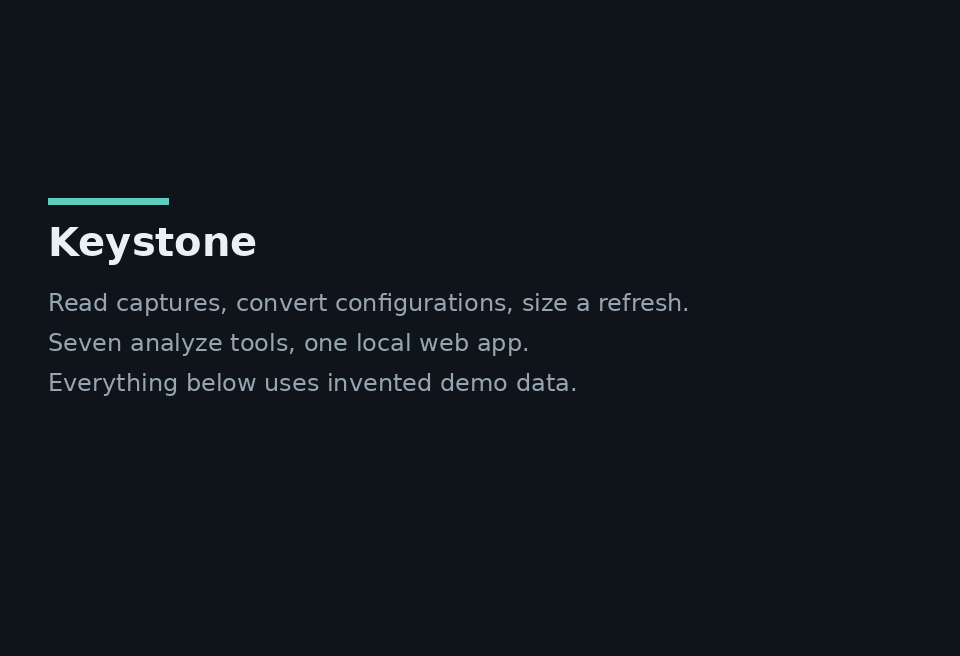
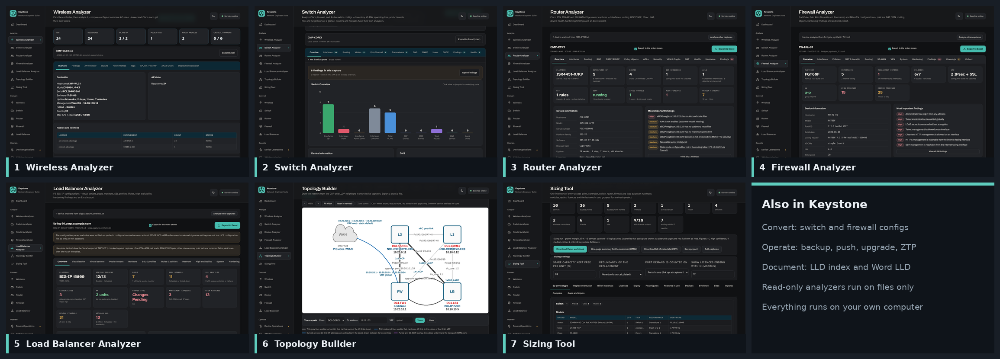
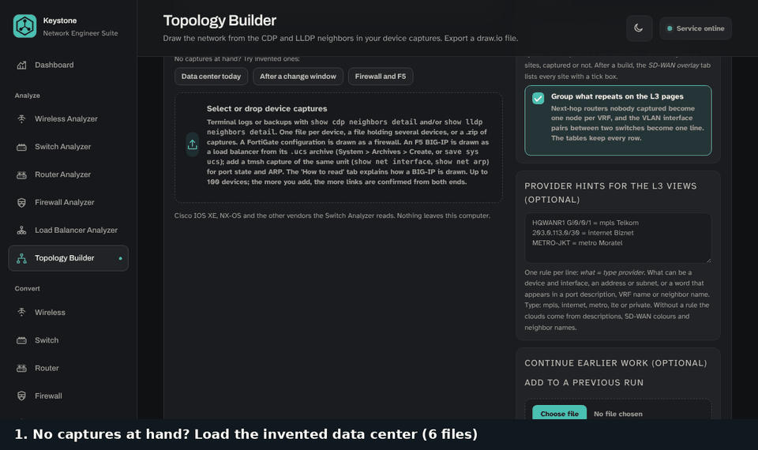

# Keystone

[](https://github.com/Crawling-Bil/Keystone/actions/workflows/tests.yml)

Keystone is a local web tool for network engineers. It reads device captures and builds assessment reports (wireless, switch, router, firewall and load balancer), draws the network from the neighbours in the captures, sizes a refresh project from any mix of captures, converts configurations between vendors, writes the LLD (Low Level Design) Word document of a project, and runs firmware and configuration jobs on switches. It runs on your own computer, so customer configurations never leave your machine.

Current version: 1.12.0. Indonesian guide: [docs/PANDUAN.md](docs/PANDUAN.md). Every tool explained step by step, for a first-time user and for an expert: [docs/TOOLS_GUIDE.md](docs/TOOLS_GUIDE.md) (Bahasa Indonesia: [docs/PANDUAN_ALAT.md](docs/PANDUAN_ALAT.md)).

## See it work



The seven Analyze tools, each with its result:



| Tool | You give it | You get |
| --- | --- | --- |
| [Wireless Analyzer](docs/TOOLS_GUIDE.md#3-wireless-analyzer) | Cisco 9800 or Huawei AC capture | APs, WLANs, tags, licences, findings, AP role diff |
| [Switch Analyzer](docs/TOOLS_GUIDE.md#4-switch-analyzer) | Cisco, Huawei or Aruba switch capture | VLANs, spanning tree, port-channels, PoE, optics, health, findings |
| [Router Analyzer](docs/TOOLS_GUIDE.md#5-router-analyzer) | Cisco IOS, IOS-XE or SD-WAN capture | Interfaces, routing, BGP / OSPF, VPN, NAT, findings |
| [Firewall Analyzer](docs/TOOLS_GUIDE.md#6-firewall-analyzer) | FortiGate, Palo Alto, MikroTik | Policies, NAT, VPN, routing, hardening findings |
| [Load Balancer Analyzer](docs/TOOLS_GUIDE.md#7-load-balancer-analyzer) | F5 BIG-IP `.ucs` or `tmsh` | Virtual server to pool map, SSL, HA, findings |
| [Topology Builder](docs/TOOLS_GUIDE.md#8-topology-builder) | One capture per device | draw.io diagram with the ports on every line |
| [Sizing Tool](docs/TOOLS_GUIDE.md#9-sizing-tool) | Any mix of captures | One inventory with hardware, licences, features, and a replacement plan |

All pictures use invented captures that ship with Keystone or with its tests; no customer data is shown. The Topology Builder also has a five-minute walk-through with talking points: [docs/PRESENTER_SCRIPT.md](docs/PRESENTER_SCRIPT.md).



## Quick start

There is no account and no login. You download it, start it, and the browser opens.

**Windows**

1. Install Python from [python.org](https://www.python.org/downloads/windows/) (once). The latest release is fine: Keystone needs Python 3.11 or newer (the tests pass on 3.12, 3.13 and 3.15). Tick **Add python.exe to PATH** in the installer.
2. On this page press the green **Code** button, then **Download ZIP** ([GitHub's steps](https://docs.github.com/en/repositories/working-with-files/using-files/downloading-source-code-archives)). Right-click the ZIP, choose **Extract All**, and open the extracted `Keystone` folder.
3. Double-click **`start_windows.bat`**.

**macOS or Linux**

1. Install Python 3.11 or newer if you do not have it (macOS: `brew install python@3.12`, Debian or Ubuntu: `sudo apt install python3 python3-venv python3-pip`).
2. Download and unzip the repository, or run `git clone https://github.com/Crawling-Bil/Keystone.git`.
3. In a terminal, in the Keystone folder, run `bash start_mac_linux.sh`.

The first start installs everything it needs by itself. That takes 2 to 5 minutes and needs internet; keep the window open. After that, Keystone opens in your browser at `http://127.0.0.1:8002` and every later start takes a few seconds. Leave the black window open while you work, and close it (or press Ctrl+C) to stop Keystone.

Windows may show "Windows protected your PC" for a downloaded `.bat` file. Press **More info**, then **Run anyway**. The scripts are plain text; open them in Notepad if you want to read them first.

### Is it safe without a login?

Keystone only listens on your own computer (`127.0.0.1`), so another machine on the network cannot reach it, and it also refuses requests that another website tries to send to it from your browser. Anyone who is signed in to your computer can use it, the same as any other program on it. Do not expose it on a network (see `NES_ALLOW_REMOTE` in Settings) unless that network is trusted and isolated, because the Operate tools can push firmware and configuration to real devices.

## What it does

Each Analyze tool is explained step by step, with pictures, in [docs/TOOLS_GUIDE.md](docs/TOOLS_GUIDE.md).

| Group | Tool | What you give it | What you get |
| --- | --- | --- | --- |
| Analyze | Wireless Analyzer | Pick the controller first. Huawei: `display current-configuration` + AP Info, or a terminal log with `display ap all` / `display radio all` / `display ap lldp neighbor brief`. Cisco 9800: `show tech-support wireless` | Per-vendor tables (Cisco: WLAN, Policy Profile, Policy/Site/RF Tag, AP Join/Flex/RF, APs with tags; Huawei: VAP, SSID, security, AP group, radio planning, radios and AP uplinks from the runtime tables), findings, AP master validation, AP role diff, source-to-target delta |
| Analyze | Switch Analyzer | Cisco (Catalyst, Nexus), Huawei, Aruba (ArubaOS-Switch, AOS-CX) configuration and `show` output | Inventory, VLANs, spanning tree, port-channels, vPC/M-LAG, PoE, transceivers, findings, Excel export (with a Health Details sheet) |
| Analyze | Router Analyzer | Cisco IOS, IOS-XE or SD-WAN capture | Interfaces, routing, BGP/OSPF, VPN, hardening findings |
| Analyze | Firewall Analyzer | FortiGate, FortiSwitch, Palo Alto (configuration or runtime log), MikroTik RouterOS 6/7 | Policies, NAT, VPN, routing, objects, hardening findings |
| Analyze | Load Balancer Analyzer | F5 BIG-IP `.ucs`, `bigip.conf` or `tmsh` output | Virtual server to pool map, monitors, SSL, HA, DNS (GTM), findings |
| Analyze | Topology Builder | Captures (or a ZIP) of switches, routers, FortiGate, Palo Alto and F5 BIG-IP (`.ucs` or `tmsh`), with CDP / LLDP neighbors, optionally MAC / ARP tables and routing facts | draw.io diagram with L3 over L2, L3 logical and route, logical IP, physical, vPC and F5 map views (keeps your layout between runs), neighbors from ARP / MAC / descriptions where CDP/LLDP is silent, one page per site on large networks, SD-WAN overlay and provider clouds, trace of a path, link speeds, documentation pack (ZIP / HTML report), Excel, link, bundle, host and L3 tables, devices behind uncaptured devices, the captures to take next, merge with a previous run, optional anonymized copy, a progress bar while it builds |
| Analyze | Sizing Tool | Any mix of captures of access points, controllers, switches, routers, firewalls and load balancers (Cisco, Huawei, Aruba, FortiGate, Palo Alto, F5, MikroTik) | One inventory: hardware, modules, optics, licences and features in use; partial captures of one device merged; HA and vPC pairs found from the configuration; replacement plan from the per-unit capacity you type (spare, N+1 / 2N); firewalls sized on the throughput that matches their inspection; licence tier the replacement needs and renewal windows; Excel, bill of materials (CSV), one-page summary, saved project |
| Convert | Convert Switch | Cisco, Huawei or Aruba switch configuration (Aruba 2540 / ArubaOS-Switch and AOS-CX), or a terminal session capture of it | Configuration for another vendor, interface map, pre-flight summary; every statement without a safe equivalent is a `REVIEW-` line |
| Convert | Convert Firewall | MikroTik configuration | Palo Alto (Panorama-ready) configuration, in one click or step by step (Guided Conversion: target model, interface and VLAN mapping, zones, checked at every step) |
| Convert | Wireless, Router, Load Balancer | none yet | These pages say what is needed first and link to the matching analyzer |
| Operate | Device Operations (Devices, Backup, Config Push, Upgrade, Live Logs), ZTP Provisioning | Device credentials, firmware, draft configuration | Firmware upgrade, configuration push, zero-touch provisioning (these change real devices) |
| Operate | Config Backup, Live Logs | Device credentials | Read-only backup bundle, live job log |
| Document | LLD Index | Project details and goals, device inventory (Excel template), optional configs | The LLD chapter structure per technology (switch, wireless, firewall; router and load balancer as drafts), per site and device, tables filled from the configs, rack layout (Before/After for a replacement project), narrative from the goals. Saved per project |
| Document | Document Generator | An index from LLD Index (one click) or an Excel index; project data for the forms | The Word LLD, Work Plan (FM-Impl-039) and Work Report (FM-HW-005). LLD: on the master template: cover, footer and Document Control filled from the project, customer logo, chapters, tables and pictures, Document Acceptance with your approvers, release history |

## Requirements

- Windows, macOS or Linux.
- Python 3.11 or newer. The automatic tests run on Python 3.12, 3.13 and 3.15 (the whole suite passes on all three); take 3.12 or 3.13 if you have a choice, and any newer release works too: the setup scripts take the newest Python 3.11 or later they find. On a Python release that is only a few weeks old a few packages (PyYAML, for one) may have no ready-made wheel yet; pip then builds them on the spot, which is slower but works without a C compiler. Download: [python.org](https://www.python.org/downloads/). How the Windows installer and the `py` command work: [Python on Windows](https://docs.python.org/3/using/windows.html).
- Internet access on the first start only, to download the packages listed in `requirements-lock.txt`.
- A current browser.
- Optional: `dnsmasq`, only if you use the built-in DHCP server of ZTP Provisioning (`apt install dnsmasq` or `brew install dnsmasq`).

## Start and stop

| | Windows | macOS or Linux |
| --- | --- | --- |
| Start | double-click `start_windows.bat` | `bash start_mac_linux.sh` |
| Stop | close the window, or double-click `stop_windows.bat` | Ctrl+C, or `bash stop_mac_linux.sh` |
| Open the page again | double-click `open_nes.bat`, or go to `http://127.0.0.1:8002` | go to `http://127.0.0.1:8002` |
| Install again or repair | double-click `setup_windows.bat` | `bash setup_mac_linux.sh` |
| Check the installation | `.venv\Scripts\python.exe verify_install.py` | `.venv/bin/python verify_install.py` |

If you start Keystone while it is already running, it just reopens the browser instead of failing.

If your security software blocks the scripts, do the same by hand from the Keystone folder. On Windows:

```bat
py -3 -m venv .venv
.venv\Scripts\python.exe -m pip install -r requirements-lock.txt
.venv\Scripts\python.exe run.py
```

On macOS or Linux replace `.venv\Scripts\python.exe` with `.venv/bin/python` and `py -3` with `python3`.

## Update to a newer version

With git: `git pull`, then run the setup file once (`setup_windows.bat` or `bash setup_mac_linux.sh`) in case the package list changed. With a ZIP: download the new ZIP, extract it to a new folder, and copy the old `data` folder into it if you want to keep your activity history. Then run the setup file once.

## Your first analysis (five minutes)

1. Open **Switch Analyzer** in the left menu and choose the **Collect Backup** tab.
2. Download the command list for your platform (Cisco Catalyst, Cisco Nexus, Aruba Switch, Aruba CX, Huawei S/L/E-series or Huawei H-series), or press **Copy commands** and paste it into your SSH or console session.
3. Save the whole terminal output as one `.txt` file.
4. Go to **Single Device**, drop the file in, leave Vendor on Auto Detect and press **Analyze Switch**.
5. Read **Overview**, **Findings** and **Health**, then **Export to Excel (.xlsx)** for the report.

The other analyzers work the same way. Each has a Collect Backup tab or list for its platforms: Cisco IOS-XE and SD-WAN routers, FortiGate, MikroTik, Palo Alto, F5 BIG-IP (LTM and DNS). Which commands to capture, how to read each tab and what the findings mean are in [docs/TOOLS_GUIDE.md](docs/TOOLS_GUIDE.md).

A file that belongs to another tool (for example a router capture on the Switch page) is not forced through the wrong parser. The page tells you which analyzer to use.

## Convert a switch configuration

1. Open **Convert**, then **Switch**.
2. Choose the configuration file or paste it. Source Vendor can stay on Auto Detect.
3. Pick the Target Vendor. Pick a Target Model if you know it: Keystone then checks every used port against the real model and tells you if the target has too few ports.
4. For a Huawei stack, set **Stack member** and **Units in the stack**. Convert each old switch as its own file.
5. Optionally pick a Standard Config Profile, then press **Convert Configuration**.
6. Read the three views of the result:
   - **Configuration**: source and converted text side by side. Download it with **Download CFG**.
   - **Interface map**: every source port, the port it becomes, and why. A banner says whether the target model fits.
   - **Pre-flight**: what converted cleanly, what needs a decision, what was not converted, and structural checks such as duplicate ACL rules and empty port-channels.
7. Search the output for `REVIEW-`. Every such line is a decision or a missing equivalent that a person must settle before the configuration goes on a device.

What the converter carries over, and what it leaves for you:

- Only what the source states is written. A port whose PoE the source never mentioned gets no PoE line (every vendor powers a PoE port by default); a port the source switched off keeps it off.
- Fixed speed and duplex (`speed 100` / `duplex full`, `speed-duplex 100-full`) and DHCP-client addresses (`ip address dhcp`, `ip address dhcp-bootp`, `ip dhcp`, `ip address dhcp-alloc`) are written on every target. A fixed port also gets a `REVIEW-SPEED` line, because the far end must be fixed the same way or you get a duplex mismatch. AOS-CX accepts `ip dhcp` only on the management interface and VLAN 1, so any other interface gets a `REVIEW-DHCP-CLIENT` line.
- A `show tech-support` or other terminal capture is read for its running configuration only; an Aruba 2540 capture of tens of thousands of lines no longer becomes the configuration. Banners keep their kind (`motd`, `exec`, `login`) and their text.
- Lines that have no equivalent on the target stay visible as `REVIEW-` lines instead of being dropped silently.

Several files or a ZIP can be converted in one go with **batch conversion**. Details and the rules behind the converter are in [docs/modules/configuration-studio.md](docs/modules/configuration-studio.md).

## Draw a network topology

1. Open **Analyze**, then **Topology Builder**. Select or drop one capture per device (or a ZIP; for an F5 BIG-IP the `.ucs` archive, plus a `tmsh` capture of the same unit for port state and ARP). The more devices you add, the more links are confirmed from both ends.
2. Optional: type a **Topology name**. Every download is then named after it (`Lab-DC-topology.drawio`, `Lab-DC-links.csv`, ...); empty keeps the plain names. The draw.io file shows the name and `Topology Created at Date YYYY:MM:DD - Time HH:MM:SS` above the diagram.
3. Check the options (defaults in brackets):
   - **Exclude IP phones, PCs and servers** (on): draw network devices only. While it is on, the phone/host options are hidden.
   - **Collapse phones and hosts into one node per switch** (on), **Group end points under the same switch** (on, when end points are drawn one by one: one frame per switch around its phones, PCs and servers) and **Collapse access points into one node per switch** (on: one box per switch; clear it to draw every access point with its own hostname, model and IP address, framed under its switch).
   - **Show port names on the lines** (on), **Show the address of routed ports on the lines** (on), **Infer neighbors where CDP/LLDP is silent** (on; order of trust: ARP, then MAC address, then port description), **Add routed /30 and /31 links** (on), **Leave out-of-band management links out of the picture** (on), **Draw end hosts learned from MAC tables** (off).
   - **Grouping**: Automatic (default: one page per site when the network is large), one diagram, or group by the first one, two or three hostname words (`JKT`, `JKT-A02`, `JKT-GD1-LT1`), or **Sites, smart** (hostname families that tolerate small differences, corrected by the cables: `HQWANR1` and `HQ-ACC1` are one site, `LT2` and `LT02` are one floor). Automatic uses the smart sites when the plain prefixes do not show the sites. Each group is drawn in a black frame; the group with the most links to other groups is in the middle.
   - **Diagram file contains**: all views in one file (default), **L3 over L2** (L3 links drawn on top of the cables that carry them), **L3 - Logical and Route** (links proven by routing tables and neighbors), **L3 - Logical view** (shared subnets, interface addresses), **L2 physical and vPC**, physical only, vPC only, or the **F5 map** (virtual servers, pools, members, nodes of each BIG-IP).
   - **Line shape** (straight, bent once around a device, or curved) and **Style lines by** (rated speed or link state).
   - **SD-WAN sites on the L3 pages**: only the sites you captured (default; the rest is one cloud) or every site in the BFD tables, optionally a list of the sites to draw. **Group what repeats on the L3 pages** (on) turns next-hop routers nobody captured into one node per VRF and VLAN interface pairs between two switches into one line; the tables keep every row.
   - **Provider hints** (optional): one rule per line, for example `HQWANR1 Gi0/0/1 = mpls Telkom` or `203.0.113.0/30 = internet Biznet`, to name the provider clouds on the L3 views.
   - **Also make an anonymized copy** (off): a second pack where hostnames, domain names, descriptions, VRF and F5 object names, IP addresses, MAC addresses and serial numbers are replaced the same way everywhere, plus a key file. Keep the key on your own computer.
4. Press **Build topology**. A progress bar shows the step (capture 3 of 7, drawing page 2 of 5, writing the pack) and the seconds so far; a second build of the same captures is much faster because the reading is cached. Then look at the preview (zoom, drag, open in a new tab) and read the findings. Download the **pack** (ZIP) for everything, or single files. The **Capture next** tab lists the devices whose capture would add the most links, and **Trace a path** follows a destination address hop by hop through the routing tables.
5. To continue later, pick the `topology.json` under **Add to a previous run** and the `topology.drawio` you moved things in under **Keep my layout**.

The pack contains `run-settings.txt`: the options you set, the creation time and the topology name. Send it together with a question or a bug report. Everything else, including finding IDs (TOPO-001 ...) and what each option does, is in [docs/modules/topology.md](docs/modules/topology.md).

## Size a refresh

1. Open **Analyze**, then **Sizing Tool**. Type a project name and the growth margin. No captures at hand? Press the demo **Campus with wireless and licences**.
2. Drop the captures of every device you want to count (any mix of vendors and device types, one file each, or a ZIP). Add more later with **Add captures**.
3. Press **Build the sizing inventory**. Read **By device type** first, then **Gaps and inputs**: it lists what the captures did not say (licence output, transceivers, peak figures) so that you know where the numbers are thin.
4. In **Replacement plan** type the capacity of one unit of the model you are considering (from its datasheet), the spare capacity to keep free and the redundancy (none, N+1, 2N). The tool counts the units. Save candidate models in the library and compare two side by side.
5. Read **Licences** (what is in use, the tier the replacement needs, renewal windows that can be co-termed) and **Expiry**.
6. Download the **Excel workbook**, the **bill of materials (CSV)** or the **one-page summary** (HTML), and **Save project** to reopen the run later.

Nothing is priced and no product catalogue is bundled: the per-unit capacity is yours. Every figure shows where it came from. Details and every option: [docs/modules/sizing-tool.md](docs/modules/sizing-tool.md); the same steps with pictures: [docs/TOOLS_GUIDE.md](docs/TOOLS_GUIDE.md#9-sizing-tool).

## Write an LLD document

1. Open **Document**, then **LLD Index**. Fill in the customer, project name, code, your name and the project goals. Turn on **Replacement project** when old devices are replaced.
2. Pick the technologies (Switch, Wireless, Firewall, ...).
3. Add the devices: **Download template**, fill it in Excel (Site, Hostname, Model, Role, Status, Mgmt IP, SN, Config, Rack, Rack Size, U, U Height) and **Import CSV / XLSX**, or type the rows. Status is New, Existing (removed) or Keep.
4. Optional: drop the running configs (one per device, or a ZIP). VLAN, interface, routing and policy tables are filled from them; without configs those tables stay TBD.
5. Press **Build LLD index**. The build is saved: next time pick it under **Continue a project**, change what you need and build again without uploading the configs again.
6. Press **Open in Document Generator**. The project opens with all chapters. Building again later updates the same project and keeps your pictures and edits.
7. In the Document Generator: drop, paste or choose the topology and rack pictures (SVG from Topology Builder works; **Pictures** places several at once by file name), fill what **Review** lists as still to do, and set the customer logo, version and **Approvers** in **Settings**.
8. Press **Generate & Download**. Open the file in Word and let it update the fields (table of contents, captions).

The first time, open **Document Generator** and press **Import from the old Document Generator** to bring over projects made with the separate Document Generator app. Details: [docs/modules/lld-index.md](docs/modules/lld-index.md) and [docs/modules/lld-generator.md](docs/modules/lld-generator.md).

## Tools that change devices

Device Operations and ZTP Provisioning write to real devices. Real runs support Huawei VRP only; other vendors run in demo mode. Firmware upgrade and Config Push run a pre-check and take a configuration backup around the job. Use Demo Mode to rehearse first. Every request that starts or changes a job in these two tools is also written to `logs/audit.jsonl`: time, address, the names of the submitted fields and the target host or serial, never a password or configuration text. Each line carries the hash of the line before it, so a changed or deleted line is detectable (`python -c "from core import audit_log; print(audit_log.verify())"`). The Backup and Live Logs tabs are read-only. Read [docs/modules/lifecycle-manager.md](docs/modules/lifecycle-manager.md) before the first real job.

## Settings (optional)

You do not need any of these. Set them as environment variables before you start Keystone.

| Variable | Default | Meaning |
| --- | --- | --- |
| `NES_PORT` | `8002` | Port to listen on |
| `NES_HOST` | `127.0.0.1` | Address to listen on. Anything other than localhost also needs `NES_ALLOW_REMOTE=1` |
| `NES_ALLOW_REMOTE` | unset | Set to `1` to let another machine connect. There is no login, so only on a trusted, isolated network |
| `NES_ALLOWED_HOSTS` | unset | Extra host names Keystone should answer to, separated by commas |
| `NES_OPEN_BROWSER` | `1` | Set to `0` to stop the browser opening at start |
| `NES_SECRET_KEY` | generated | Signing key for cookies |

On Windows, open Command Prompt in the Keystone folder, run for example `set NES_PORT=8010`, then `start_windows.bat`. Variables set that way last only for that window. On macOS or Linux: `NES_PORT=8010 bash start_mac_linux.sh`.

## Troubleshooting

| What you see | What to do |
| --- | --- |
| "Python 3.11 or newer was not found" | Install Python from [python.org](https://www.python.org/downloads/), then double-click `setup_windows.bat` (macOS or Linux: `bash setup_mac_linux.sh`) again. To pick one Python: `PYTHON_BIN=python3.12 bash setup_mac_linux.sh` |
| "Windows protected your PC" | Press **More info**, then **Run anyway** |
| Setup stops while installing packages | Check internet access and any company proxy (pip reads `HTTPS_PROXY`), then run the setup file again |
| Antivirus deletes or blocks a script | Allow the Keystone folder, or use the manual commands in Start and stop |
| "Could not create the private Python folder" (Debian or Ubuntu) | `sudo apt install python3-venv python3-pip`, then run setup again |
| `bash: ... No such file` or strange `\r` errors on macOS/Linux | The script has Windows line endings. Run `sed -i 's/\r$//' *.sh` (macOS: `sed -i '' 's/\r$//' *.sh`) in the Keystone folder |
| "Port 8002 is already used by another program" | Another program owns the port. Start on a different port with `NES_PORT=8010` (see Settings) |
| "Keystone is already running" | It is. The browser reopens; use that tab |
| Browser does not open | Go to `http://127.0.0.1:8002` yourself |
| "Keystone only answers on this computer's own addresses" | You opened it with a different name or address. Use `http://127.0.0.1:8002` or `http://localhost:8002` |
| "Refusing to listen on ..." | `NES_HOST` is set to a non-local address. Remove it, or also set `NES_ALLOW_REMOTE=1` if you accept the risk |
| "Keystone refused a request that another website started" | A page other than Keystone tried to send a request. Close that tab and use the Keystone tab |
| An analyzer says the file is not recognised | Use the matching analyzer, or collect the output again with the command list from the Collect Backup tab |
| Results look incomplete | Collect with the full command list for the platform. The Coverage tab of the Switch Analyzer shows which commands were found |
| ZTP built-in DHCP does not start | Install `dnsmasq` and run Keystone with administrator or root rights; DHCP uses a privileged port |
| Setup finished but something fails later | Run the check in Start and stop and read what it reports |

## Your data

- Uploaded files, exports, logs and generated settings stay in `data/`, `uploads/`, `exports/` and `logs/` inside the Keystone folder. They are ignored by git on purpose.
- LLD work is kept in `data/nes.db` (saved LLD Index projects, Document Generator projects, Work Plan and Work Report data, approvers) and `data/lld_generator/` (templates, pictures, generated Word files; generated files older than 7 days are removed). Back up the `data` folder to keep it.
- Never commit real customer captures or credentials. The tests use synthetic files only.
- Keystone does not send configurations to any external service.

## More documentation

- [docs/PRD.md](docs/PRD.md): scope, supported vendors, roadmap (Indonesian)
- [docs/TOOLS_GUIDE.md](docs/TOOLS_GUIDE.md): the seven Analyze tools step by step, for newcomers and experts, with vendor documentation links
- [docs/PANDUAN_ALAT.md](docs/PANDUAN_ALAT.md): the same guide in Bahasa Indonesia
- [docs/PANDUAN.md](docs/PANDUAN.md): user guide in Bahasa Indonesia (install, update, convert, LLD)
- [docs/modules/configuration-studio.md](docs/modules/configuration-studio.md): how Convert works, Nexus, stacks, hardware catalog
- [docs/modules/lifecycle-manager.md](docs/modules/lifecycle-manager.md): upgrade, push, backup and ZTP
- [docs/modules/wireless.md](docs/modules/wireless.md): Wireless Analyzer, Huawei terminal logs and runtime tables
- [docs/modules/topology.md](docs/modules/topology.md): every Topology Builder option and finding
- [docs/modules/sizing-tool.md](docs/modules/sizing-tool.md): Sizing Tool inputs, plan, licences, project file
- [docs/modules/panorama.md](docs/modules/panorama.md): Palo Alto Panorama in the Firewall Analyzer
- [docs/modules/lld-index.md](docs/modules/lld-index.md): LLD index templates, inventory columns, rack layout, saved projects
- [docs/modules/lld-generator.md](docs/modules/lld-generator.md): Document Generator, master template placeholders, Work Plan and Work Report, approvers, import from the old Document Generator
- [CONTRIBUTING.md](CONTRIBUTING.md): reporting problems, keeping real data out, running the tests
- [CHANGELOG.md](CHANGELOG.md)

## Development

```bash
pip install -r requirements-dev.txt
python -m pytest -q
pre-commit install    # optional: runs ruff before every commit
```

The same checks run on GitHub for every pull request ([.github/workflows/tests.yml](.github/workflows/tests.yml)): the tests on Windows and Linux, a browser regression run, a coverage floor, `ruff` and `pip-audit`. A rule can carry optional `standards` (control identifiers such as a CIS or NIST SP 800-53 control) and `evidence` (the configuration line it was raised from) through `analyzer_core.findings.finding()`; the Findings sheet shows those two columns when a rule fills them in. Dependencies are pinned in `requirements-lock.txt`; [SECURITY.md](SECURITY.md) says how to report a vulnerability.

The tool list lives in `core/modules.py`. To add a module, register its blueprint in `app.py` and add an entry there. Adding a converter is described in `docs/modules/configuration-studio.md`. The Word engine shared by the document tools is `core/docgen/` (docgen, importer, placeholders, and the master template in `core/docgen/master/`); change `docgen.py` only together with a test that compares the generated document. `core/local_guard.py` is the small guard that keeps other websites from calling Keystone; keep new routes behind the same app so they get it.

## License

See [LICENSE](LICENSE). It is an internal-use notice, not an open-source licence: ask the repository owner before you reuse or redistribute the code.
