# Panduan tool Keystone: tujuh tool Analyze

Halaman ini menjelaskan apa yang dikerjakan tiap tool Analyze, perintah apa yang harus diambil, cara menjalankannya, dan cara membaca hasilnya. Bagian **Mulai di sini** untuk Anda yang belum pernah membuka Keystone. Bagian **Lebih dalam** untuk engineer yang sudah paham platformnya dan ingin tahu apa yang dilakukan tool dengan datanya. Versi bahasa Inggris: [TOOLS_GUIDE.md](TOOLS_GUIDE.md). Cara memasang dan menjalankan: [PANDUAN.md](PANDUAN.md).

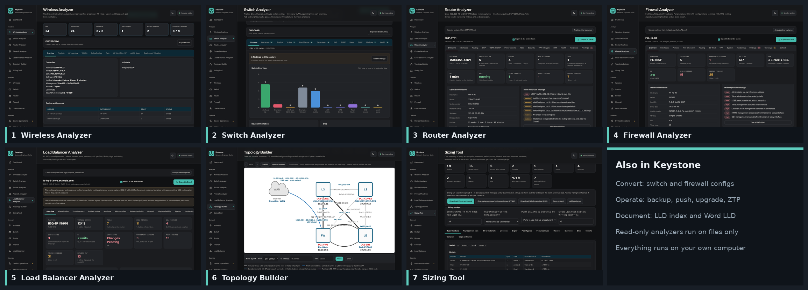

Semua gambar dan rekaman di halaman ini memakai capture **rekaan** (nama seperti `CMP-CORE1`, alamat dari rentang dokumentasi). Tidak ada data pelanggan di repository ini.

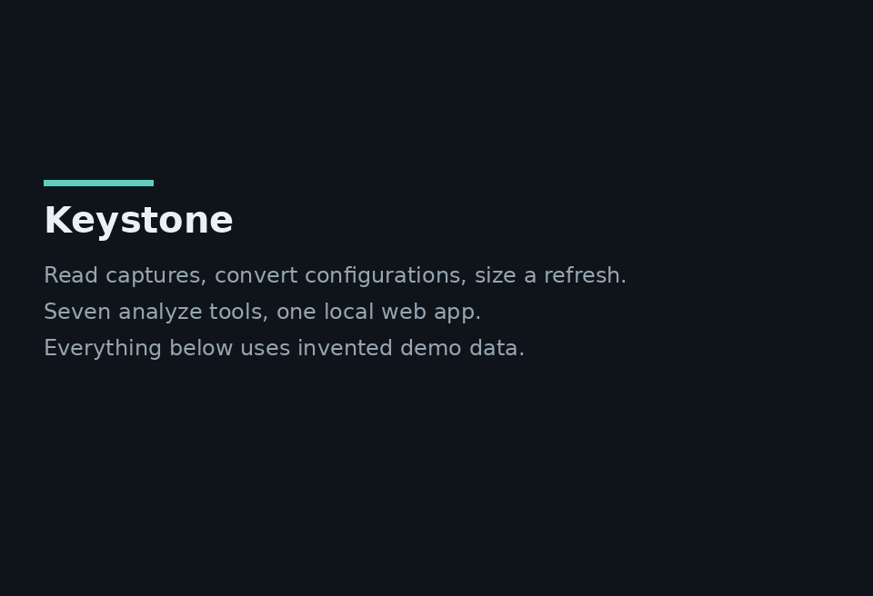

**Isi halaman**

1. [Cara kerja semua tool Analyze](#1-cara-kerja-semua-tool-analyze)
2. [Tool mana yang saya buka?](#2-tool-mana-yang-saya-buka)
3. [Wireless Analyzer](#3-wireless-analyzer)
4. [Switch Analyzer](#4-switch-analyzer)
5. [Router Analyzer](#5-router-analyzer)
6. [Firewall Analyzer](#6-firewall-analyzer)
7. [Load Balancer Analyzer](#7-load-balancer-analyzer)
8. [Topology Builder](#8-topology-builder)
9. [Sizing Tool](#9-sizing-tool)
10. [Satu capture, beberapa tool](#10-satu-capture-beberapa-tool)
11. [Istilah yang akan Anda temui](#11-istilah-yang-akan-anda-temui)
12. [Kalau ada yang tidak jalan](#12-kalau-ada-yang-tidak-jalan)
13. [Dokumentasi rujukan](#13-dokumentasi-rujukan)

---

## 1. Cara kerja semua tool Analyze

### Mulai di sini

Tool Analyze tidak pernah terhubung ke jaringan Anda. Anda mengambil sendiri output perintah `show` (atau `display`, `get`, `tmsh`), menyimpannya sebagai file teks, lalu memberikannya ke Keystone. Keystone membaca teks itu, membuat tabel dan daftar temuan, dan Anda bisa mengunduh laporan Excel. Semuanya berjalan di komputer Anda sendiri.

Empat langkah yang sama berlaku untuk kelima analyzer (Wireless, Switch, Router, Firewall, Load Balancer):

1. **Ambil.** Buka tool, lalu tab **Collect Backup** (atau tombol **Collect lists** / **Commands to capture**) dan ambil daftar perintah untuk platform Anda. Salin perintahnya, tempel di sesi SSH atau console, lalu simpan **seluruh** output terminal sebagai satu file `.txt`. Log terminal tidak masalah: prompt dan perintah yang Anda ketik justru dipakai Keystone untuk menemukan awal tiap output.
2. **Unggah.** Seret file ke halaman. Biarkan vendor di **Auto Detect** kecuali halaman meminta Anda memilih controller dulu (Wireless). Beberapa file, atau satu ZIP, boleh sekaligus; tiap file dibaca sebagai satu perangkat.
3. **Baca.** Mulai dari **Overview**, lalu **Findings**. Tiap temuan punya tingkat keparahan, objeknya, alasan kenapa penting, perbaikannya, dan tautan ke dokumentasi vendor.
4. **Ekspor.** **Export to Excel** menghasilkan workbook berisi semua tabel, temuan, dan sheet cakupan yang menunjukkan perintah mana yang ditemukan di file Anda.

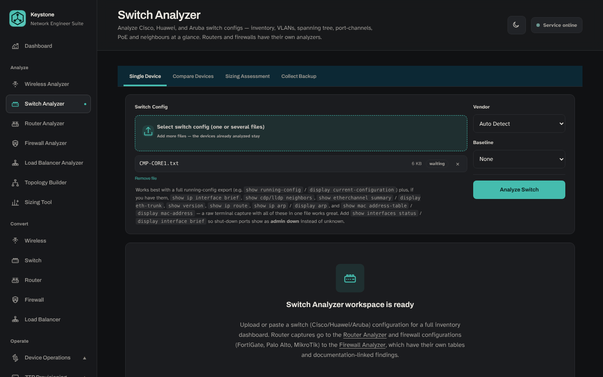

> **Catatan keamanan untuk daftar collect**
>
> - Pakai akun **read-only**. Semua perintah di daftar hanya membaca, dengan satu pengecualian: baris pertama daftar switch Cisco, Huawei dan Aruba serta daftar router IOS-XE adalah `write memory` (Huawei: `save`, lalu `y`). Perintah itu menyimpan running configuration ke startup supaya backup yang Anda ambil sama dengan yang dipakai perangkat saat boot. Kalau Anda tidak boleh mengubah apa pun di perangkat, hapus baris itu sebelum menempel daftar.
> - `terminal length 0` (atau `screen-length 0 temporary`, `no page`, `set cli pager off`) hanya mengubah paging sesi Anda sendiri.
> - Output bisa memuat community string, hash dan key. Keystone memprosesnya secara lokal dan tidak mengirimnya ke mana pun, tetapi capture yang Anda kirim lewat e-mail membawa rahasia itu. Cari `password`, `secret`, `community` dan `$M$` sebelum membagikan file.

### Lebih dalam

- **Cek Coverage dulu.** Kalau sebuah tabel kosong, buka tab **Coverage** (Switch, Firewall, Load Balancer) sebelum mempercayai hasilnya: tab itu menampilkan perintah yang dicari Keystone, mana yang ditemukan, dan mana yang ditolak perangkat. Temuan hardening "tidak ada syslog" salah kalau output `show logging` atau `show run` terpotong.
- **Satu capture per perangkat, dan per anggota pasangan.** Pasangan HA, pasangan vPC atau stack menampilkan state yang berbeda di tiap anggota (siapa yang aktif, siapa pemilik virtual MAC). Ambil kedua anggota; Keystone membaca tiap file sebagai perangkat sendiri.
- **Temuan membawa buktinya.** Sebuah rule bisa melampirkan identifier standar (misalnya kontrol CIS atau NIST) dan baris konfigurasi tempat temuan itu muncul; sheet Findings di workbook lalu menampilkan dua kolom tersebut.
- **Analyzer tidak mengubah apa pun di perangkat.** Tool yang mengubah perangkat (Device Operations, ZTP Provisioning) terpisah, ditandai "Writes to devices" di menu, dan dijelaskan di [docs/modules/lifecycle-manager.md](modules/lifecycle-manager.md).

---

## 2. Tool mana yang saya buka?

| Anda ingin tahu... | Buka | Berikan |
| --- | --- | --- |
| Apakah access point saya terdaftar, WLAN dan tag apa yang dipakai, apakah controller dikonfigurasi dengan aman? | [Wireless Analyzer](#3-wireless-analyzer) | Huawei `display current-configuration` (dan tabel AP), atau Cisco 9800 `show tech-support wireless` |
| Apa isi switch ini: VLAN, spanning tree, port-channel, PoE, optik, kesehatan? | [Switch Analyzer](#4-switch-analyzer) | Capture Cisco Catalyst / Nexus, Huawei, Aruba (ArubaOS-Switch, AOS-CX) |
| Apakah router ini sehat dan aman: routing, BGP / OSPF, VPN, NAT, SD-WAN? | [Router Analyzer](#5-router-analyzer) | Capture Cisco IOS, IOS-XE atau SD-WAN |
| Apakah policy, NAT dan VPN firewall saya wajar? | [Firewall Analyzer](#6-firewall-analyzer) | FortiGate, FortiSwitch, Palo Alto (atau Panorama), MikroTik |
| Apa yang dipublikasikan F5, ke pool mana, dengan sertifikat apa? | [Load Balancer Analyzer](#7-load-balancer-analyzer) | F5 BIG-IP `.ucs`, `bigip.conf` atau output `tmsh` |
| Bagaimana semuanya dikabel? Saya butuh diagram. | [Topology Builder](#8-topology-builder) | Satu capture per perangkat, berisi neighbor CDP / LLDP |
| Apa yang harus diganti, berapa jumlahnya, dengan lisensi apa? | [Sizing Tool](#9-sizing-tool) | Campuran capture dari jenis perangkat apa pun |

Menu juga punya **Convert** (konfigurasi switch ke vendor lain, konversi firewall MikroTik / FortiGate / PAN-OS), **Operate** (backup, config push, firmware, ZTP) dan **Document** (LLD index dan dokumen Word). Semuanya dijelaskan di [README](../README.md), [PANDUAN.md](PANDUAN.md) dan `docs/modules/`.

---

## 3. Wireless Analyzer

**Menjawab:** berapa access point yang dikelola controller ini, apakah semuanya terdaftar, WLAN / policy / tag apa yang dipakai tiap AP, apakah radio dan pengaturan keamanannya wajar, serta apa bedanya dua controller atau konfigurasi sumber dan target.

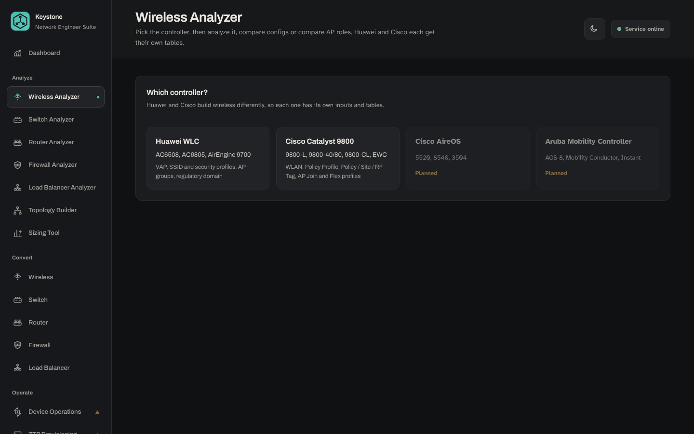

### Mulai di sini

**Apa yang diambil.** Pilih controller dulu; tiap keluarga punya tabelnya sendiri.

- **Cisco Catalyst 9800** (9800-L, 9800-40/80, 9800-CL, embedded controller): satu capture cukup, `show tech-support wireless`. Isinya konfigurasi dan state runtime AP. Alternatifnya `show running-config` ditambah `show ap summary` dan `show ap tag summary`. Rujukan perintah: [Catalyst 9800 show commands](https://www.cisco.com/c/en/us/td/docs/wireless/controller/9800/command-reference/b_wireless_cr/show-commands.html).
- **Huawei WLC** (AC6508, AC6805, AirEngine 9700): `display current-configuration`, ditambah `display ap all`, `display radio all` dan `display ap lldp neighbor brief` untuk state runtime, dan opsional ekspor AP Info (CSV / XLSX). Rujukan perintah: [display ap, WLAN AC V200R019C00](https://support.huawei.com/enterprise/en/doc/EDOC1100096312/159f8860/display-ap).
- Cisco AireOS dan Aruba Mobility Controller muncul di pemilih sebagai rencana; belum dianalisis.

**Jalankan.**

1. Buka **Wireless Analyzer** dan tekan kartu controller Anda.
2. Di **Select 9800 capture** (atau **Select WLC config**) pilih file. **AP Master** yang opsional adalah daftar rencana AP Anda beserta site, policy dan RF tag (templatenya ada di halaman); dengan itu tool juga memeriksa apakah tiap AP berada di tempat yang direncanakan.
3. Tekan **Analyze 9800** (atau **Analyze Wireless**).

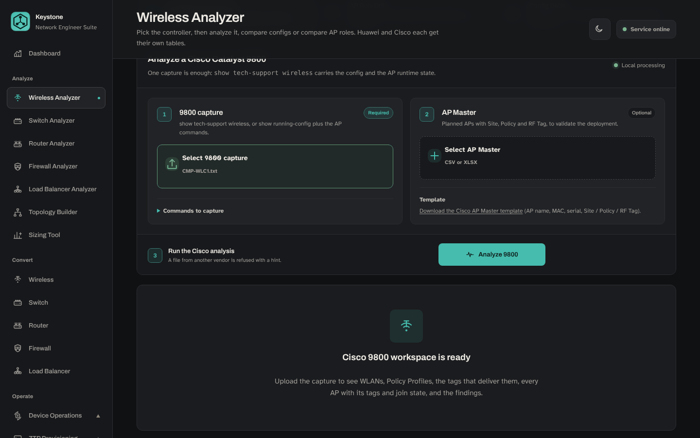

**Baca hasilnya.** Kartu di atas menampilkan jumlah AP, berapa yang terdaftar, WLAN yang up, policy tag, policy profile, dan jumlah temuan critical dan warning. Lalu telusuri tab dari kiri ke kanan: **Overview** (identitas controller, peran HA, lisensi, model AP dan apakah semuanya menjalankan software yang sama), **Findings**, **AP Inventory** (tiap AP dengan MAC, serial, IP, state, policy / site / RF tag, software), **WLANs**, **Policy Profiles**, **Tags**, **AP Join / Flex / RF**, **AAA & Users**, **Deployment Validation**.

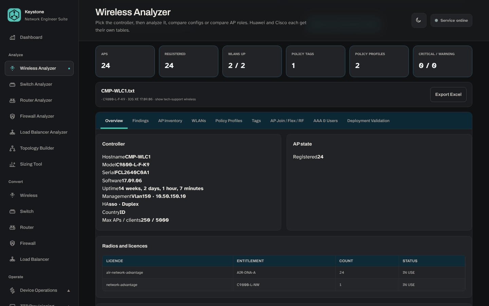

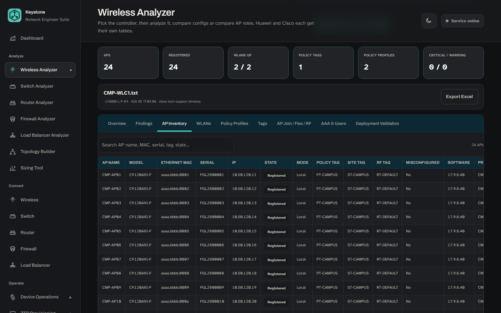

Tampilan Huawei punya konsep yang sama dengan nama Huawei: VAP profile, SSID dan security profile, AP group, regulatory domain, AP profile, **Radio Planning** dan local user.

### Lebih dalam

- **AP Role Diff** membandingkan tabel AP dua controller (aktif dan standby, atau lama dan baru) berdasarkan MAC, lalu serial, lalu nama AP. Ambil keduanya dalam selisih satu-dua menit, kalau tidak state join akan berbeda bukan karena kerusakan. Di Cisco, policy, site dan RF tag dibandingkan per AP; di Huawei, AP group.
- **Config Delta** membandingkan konfigurasi sumber dan target dan menghasilkan perintah implementasi: cara aman menyiapkan migrasi controller.
- **Log terminal Huawei.** Sesi asli sering diketik berulang. Keystone membaca tiap tabel sekali saja, seberapa sering pun sesi berulang, dan mengganti nama neighbor LLDP yang dipotong perangkat dengan `...` memakai nama lengkap dari dump detail. Tabel radio, uplink AP (AP ada di switch dan port mana), daftar AP dan flag daya (AP dengan daya PoE kurang menjadi temuan **AP Power**) berasal dari output runtime, bukan dari konfigurasi. Detail: [docs/modules/wireless.md](modules/wireless.md).
- **Radio Planning** menentukan setelan mana yang berlaku untuk tiap radio (AP menimpa group-nya), dan menandai channel tetap tanpa `calibrate auto-channel-select disable`, EIRP yang diset padahal daya otomatis masih aktif, radio mode monitor, dan radio yang dimatikan.
- File dari vendor lain ditolak dengan pesan yang menyebut vendor yang mirip, jadi file Huawei tidak lewat parser Cisco.
- **Masalah join Cisco** di luar apa yang bisa ditunjukkan konfigurasi. Untuk sisi runtime, panduan Cisco [Troubleshoot Catalyst 9800 AP Join or Disconnection Issues](https://www.cisco.com/c/en/us/support/docs/wireless/catalyst-9800-series-wireless-controllers/218396-troubleshoot-catalyst-9800-ap-join-or-di.html) adalah rujukannya.

---

## 4. Switch Analyzer

**Menjawab:** apa isi switch ini (model, serial, software, stack), bagaimana port, VLAN, trunk, spanning tree, port-channel, vPC / M-LAG, PoE dan optiknya dikonfigurasi dan apa state-nya, serta apa yang salah atau berisiko.

### Mulai di sini

**Apa yang diambil.** Buka **Switch Analyzer** dan tab **Collect Backup**, lalu ambil daftar untuk platform Anda: Cisco Catalyst, Cisco Nexus, Aruba Switch (ArubaOS-Switch), Aruba CX, Huawei S / L / E-series, atau Huawei H-series. Daftar Catalyst dimulai dengan `write memory`, lalu `term len 0`, `show clock`, `show run`, `show inventory`, `show version`, `show vlan brief`, dan berlanjut ke perintah interface, spanning-tree, port-channel, CDP / LLDP, PoE, transceiver dan logging. Simpan seluruh buffer terminal dalam satu file `.txt`.

File ekspor konfigurasi biasa juga boleh, tetapi output `show` yang mengisi tabel state (port mana yang up, siapa root spanning-tree, optik apa yang terpasang).

**Jalankan.**

1. Tetap di **Single Device**. Seret file (beberapa file dibaca sebagai beberapa perangkat).
2. Biarkan **Vendor** di **Auto Detect** dan **Baseline** di **None**.
3. Tekan **Analyze Switch**.

**Baca hasilnya.** **Overview** punya grafik interface up / down / admin-down / unknown, VLAN dan route, kartu perangkat (vendor, versi OS, model, serial, mode stack), dan di atasnya jumlah temuan per tingkat keparahan. Lalu tab: **Interfaces**, **Routing**, **ARP**, **MAC Table**, **VLANs**, **CDP/LLDP**, **Port-Channel**, **Trunks**, **Spanning Tree**, **Transceivers**, **vPC/M-LAG**, **PoE**, **DNS**, **SNMP**, **Users**, **DHCP**, **Logs**, **Findings**, **Health**, **Coverage**. Tab yang tidak ada datanya di capture Anda disembunyikan di bawah "Not in this capture", bukan menampilkan tabel kosong.

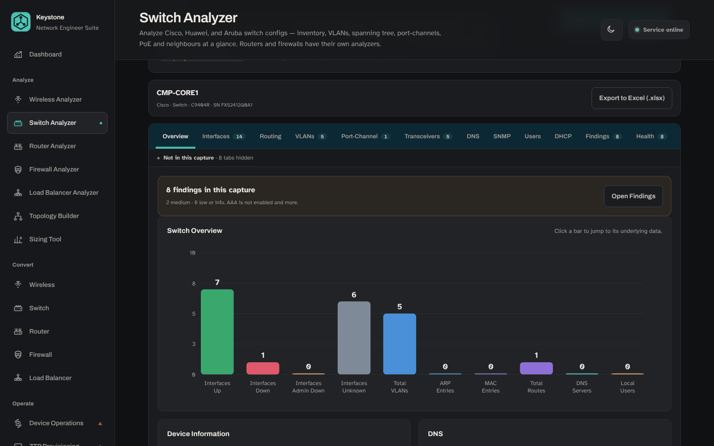

Buka **Findings** dan saring menurut severity atau kategori. Tiap temuan menjelaskan masalahnya, perbaikannya, dan menautkan dokumentasi vendor.

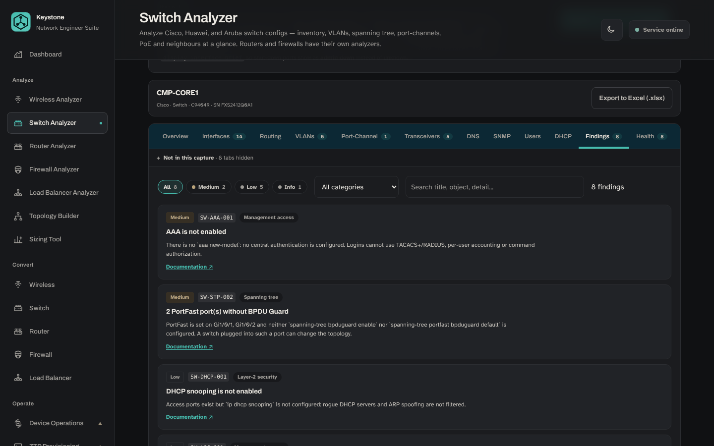

### Lebih dalam

- **Compare Devices** menampilkan dua capture berdampingan (misalnya sebelum dan sesudah perubahan, atau dua anggota pasangan). **Sizing Assessment** melihat pemakaian port dan kebutuhan penggantinya; untuk satu proyek penuh pakai [Sizing Tool](#9-sizing-tool).
- **Baseline** (di samping Vendor) memeriksa capture terhadap sebuah standar, misalnya server NTP, host syslog dan keputusan AAA dari sebuah profil converter. Penyimpangan muncul di kategori *Baseline compliance*; dengan **None** tidak ada yang berubah. Detail: [docs/modules/switch-analyzer-baseline.md](modules/switch-analyzer-baseline.md).
- **Spanning tree**: tool menampilkan root per VLAN serta peran dan tipe tiap port, dan menandai PortFast tanpa BPDU guard. Perilaku Cisco dijelaskan di [panduan spanning-tree Catalyst 9300](https://www.cisco.com/c/en/us/td/docs/switches/lan/catalyst9300/software/release/17-12/configuration_guide/lyr2/b_1712_lyr2_9300_cg/configuring_spanning_tree_protocol.html).
- **vPC dan port-channel**: untuk Nexus, baca tab vPC bersama [panduan desain dan konfigurasi vPC](https://www.cisco.com/c/en/us/support/docs/switches/nexus-9000-series-switches/218333-understand-and-configure-nexus-9000-vpc.html) dari Cisco; untuk masalah LACP ada [panduan troubleshooting LACP](https://www.cisco.com/c/en/us/support/docs/lan-switching/link-aggregation-control-protocol-lacp-8023ad/221051-troubleshoot-link-aggregation-control-pr.html).
- **Aruba CX**: `show interface status`, `show interface desc` dan `show power inline` tidak valid di AOS-CX; daftar Aruba CX memakai perintah yang valid. Rujukan perintah neighbor: [show lldp neighbor-info](https://arubanetworking.hpe.com/techdocs/AOS-CX/10.13/HTML/fundamentals_8400/Content/Chp_Dev_disc/LLDP_cmds/sho-lld-nei-inf-10.htm).
- **Stack.** Stack Huawei atau Catalyst adalah satu perangkat dengan beberapa anggota; kartu perangkat menampilkan mode stack dan tabel serial mencantumkan tiap anggota.
- Ekspor Excel punya sheet **Health Details**, jadi reviewer tanpa Keystone bisa membaca seluruh hasil.

---

## 5. Router Analyzer

**Menjawab:** bagaimana router dikonfigurasi dan kondisinya: interface, tabel routing, neighbor BGP dan OSPF / EIGRP, VPN dan crypto, NAT, ACL, hardware dan kesehatan, serta setelan mana yang melanggar baseline hardening.

### Mulai di sini

**Apa yang diambil.** Cisco IOS, IOS-XE (ISR, ASR1000, Catalyst 8200 / 8300 / 8500) atau Catalyst SD-WAN (cEdge). Buka daftar **Collect** untuk keluarga Anda. Pakai daftar IOS-XE untuk router IOS dan IOS-XE klasik, dan daftar SD-WAN untuk router dalam mode controller, karena perintah `show sdwan ...` tidak ada di router tradisional. Daftar IOS-XE dimulai dengan `write memory` dan `terminal length 0`, lalu `show clock`, `show version`, `show running-config`, `show inventory`, `show ip interface brief`, `show interfaces`, `show etherchannel summary`, CDP, dan perintah routing, BGP, OSPF, crypto dan NAT. Perintah di bawah "Health, IOS-XE only" gagal di IOS klasik; itu tidak berbahaya.

**Jalankan.**

1. Buka **Router Analyzer** dan seret capture (biarkan platform di Auto Detect kalau halaman menawarkan pilihan).
2. Tekan **Analyze**.

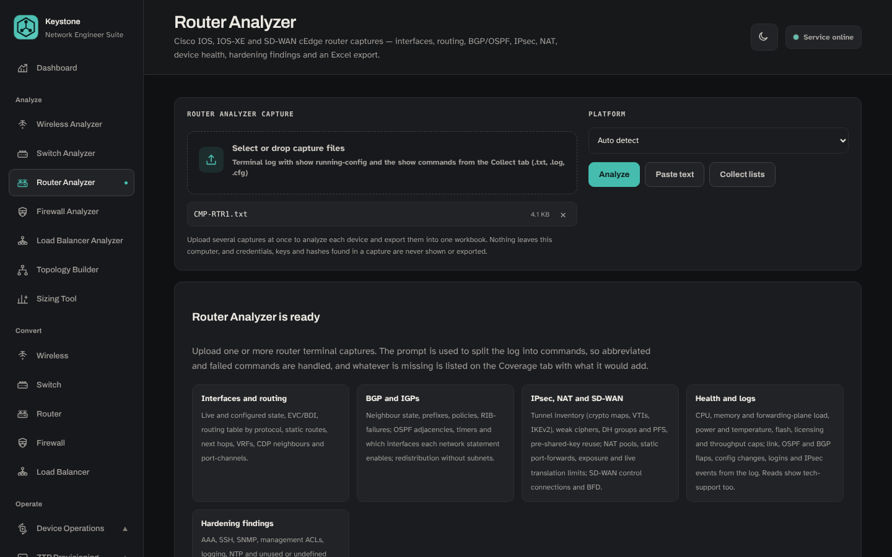

**Baca hasilnya.** **Overview** menampilkan platform, interface up, route per sumber, neighbor BGP, ACL, aturan NAT, state OSPF, tunnel IPsec, dan jumlah temuan High dan Medium, dengan temuan terpenting di samping informasi perangkat. Tab: **Interfaces**, **Routing**, **BGP**, **OSPF / EIGRP**, **Policy objects**, **ACLs**, **Security**, **VPN & Crypto**, **NAT**, **Health**, **Hardware**, **Findings**.

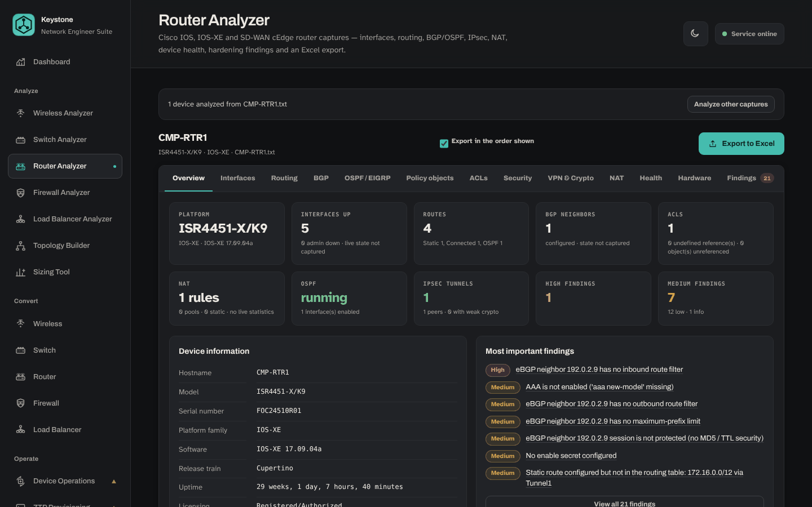

Temuan diurutkan High dulu, masing-masing dengan objek, perbaikan yang harus diketik dan tautan dokumentasi. Pada contoh rekaan, temuan High-nya adalah neighbor eBGP tanpa filter route masuk: semua yang diumumkan peer akan diterima, sehingga kebocoran atau pembajakan route langsung masuk ke tabel routing.

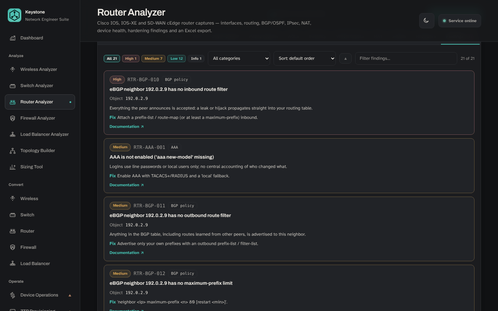

### Lebih dalam

- **State live versus konfigurasi.** Neighbor BGP "configured, state not captured" berarti output `show ip bgp summary` tidak ada di file. Kartu mengatakannya, tidak menebak; ambil daftar lengkap untuk melihat state sesi sebenarnya.
- **SD-WAN.** Untuk capture cEdge, analyzer menambahkan control connection dan sesi BFD SD-WAN ke tabel biasa. Bahan desain Cisco: [Catalyst SD-WAN design guide](https://www.cisco.com/c/en/us/td/docs/solutions/CVD/SDWAN/cisco-sdwan-design-guide.html) dan [BFD di Catalyst SD-WAN](https://www.cisco.com/c/en/us/td/docs/routers/sdwan/configuration/routing/ios-xe-17/routing-configuration-guide-17-x/cisco-catalyst-sd-wan-bfd1.html).
- **Tab Health.** Membutuhkan `show version`, tabel proses CPU dan memori, resource platform, dan sensor lingkungan. Tanpa itu tab menyebut apa yang kurang.
- **Rujukan perintah Cisco IOS** untuk tiap perintah di daftar: [IOS XE command references](https://www.cisco.com/c/en/us/td/docs/ios-xml/ios/).
- **Show tech-support juga bisa.** Capture `show tech-support` dibaca untuk CPU, memori, beban forwarding-plane, daya, suhu, flash, lisensi, batas throughput dan log (flap link, OSPF dan BGP, perubahan konfigurasi, login, event IPsec).
- Capture router yang diseret ke halaman Switch tidak dipaksa lewat parser yang salah: halaman memberi tahu Anda untuk memakai analyzer ini.

---

## 6. Firewall Analyzer

**Menjawab:** policy mana yang mengizinkan apa, apakah NAT, VPN dan routing sesuai maksud, bagaimana kotaknya dikelola dan di-hardening, dan apa yang diperbaiki dulu.

### Mulai di sini

**Apa yang diambil.**

- **FortiGate** (FortiOS 6.4 sampai 7.6): `get system status`, `show full-configuration` (konfigurasi lengkap termasuk nilai default; pada multi-VDOM jalankan dari konteks global), lalu `get router info routing-table all`, `get router info bgp summary`, `get vpn ipsec tunnel summary`, `get system ha status`, `get system performance status`. Rujukan: [FortiOS CLI reference](https://docs.fortinet.com/document/fortigate/7.6.6/cli-reference/84566/fortios-cli-reference). Capture FortiSwitch juga dibaca.
- **Palo Alto PAN-OS**: dari mode operasional `set cli pager off`, `set cli config-output-format set`, lalu `configure`, `show`, `exit`, `show system info`, `show high-availability state`, `show routing route`, `show vpn ike-sa`, `show vpn ipsec-sa`. Ekspor XML running configuration juga bisa. Rujukan: [PAN-OS CLI cheat sheet](https://docs.paloaltonetworks.com/ngfw/pan-os-cli-quick-start/cli-cheat-sheet-device-management). Ekspor **Panorama** boleh diunggah bersama ekspor firewall yang dikelolanya (maksimal 60 file); tiap firewall lalu dianalisis bersama template stack dan device group-nya.
- **MikroTik RouterOS 6 / 7**: `/export verbose` (jangan ekspor secret), ditambah `/system resource print` dan `/ip route print`.

**Jalankan.** Buka **Firewall Analyzer**, seret file, tekan **Analyze**. Pakai tab **Collect** di halaman untuk daftar yang tepat untuk platform Anda.

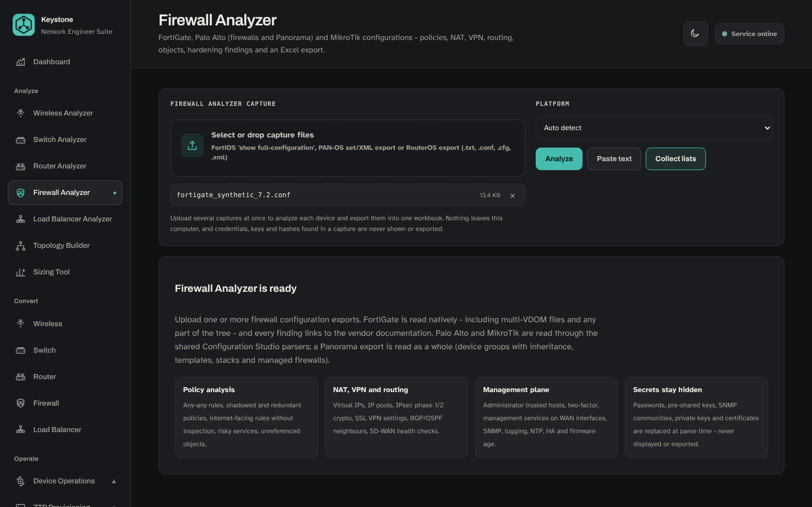

**Baca hasilnya.** **Overview** menampilkan platform dan versi, interface (dan berapa yang menghadap internet), paparan manajemen, policy (accept / deny / disabled), VPN, mode dan group HA, serta jumlah temuan High dan Medium. Tab: **Interfaces**, **Policies**, **NAT & Local-in**, **Routing**, **SD-WAN**, **VPN**, **System**, **Hardening**, **Findings**, **Coverage**, **Collect**.

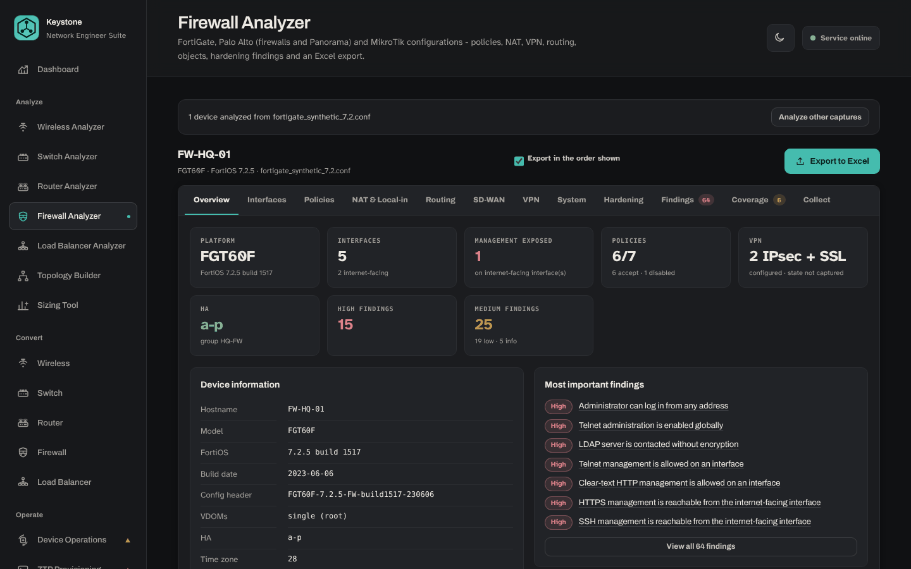

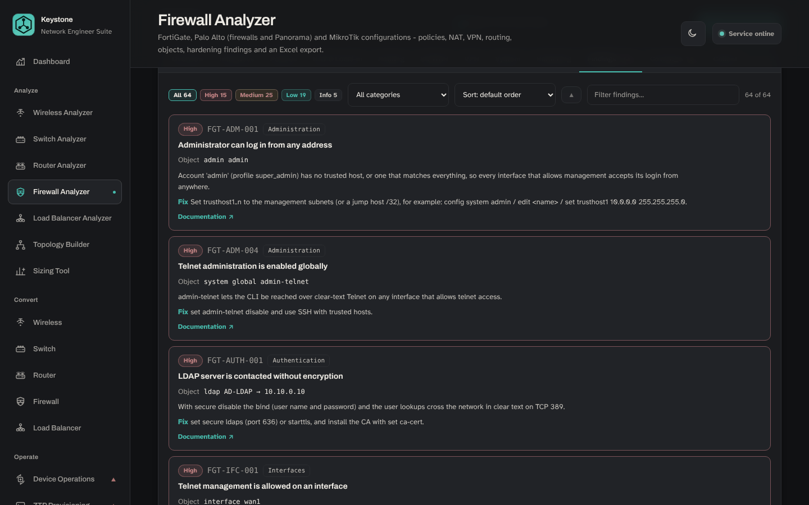

### Lebih dalam

- **Paparan manajemen** dihitung per interface: layanan administratif yang diizinkan di interface yang menghadap internet adalah temuan tersendiri, terpisah dari "service enabled globally". **Policy analysis** mencakup rule any-source / any-destination / any-service, policy yang ter-shadow dan redundan, rule menghadap internet tanpa inspeksi, layanan berisiko, dan objek yang tidak direferensikan.
- **Praktik policy Palo Alto.** Temuan mengikuti [security policy best practices](https://docs.paloaltonetworks.com/best-practices/security-policy-best-practices/security-policy-best-practices/deploy-security-policy-best-practices) PAN-OS. Untuk firewall yang dikelola Panorama urutan rule adalah pre-rule, rule lokal, lalu post-rule; lihat [hirarki rule](https://docs.paloaltonetworks.com/panorama/administration/manage-firewalls/manage-device-groups/manage-the-rule-hierarchy).
- **Tab Coverage.** Kalau output `show full-configuration` tidak ada, Coverage mengatakannya, dan temuan yang butuh nilai default (misalnya protokol yang aktif secara default) dilewati, bukan ditebak.
- **Neighbor dan ARP** di daftar (`diagnose lldprx neighbor details` di FortiOS 7.6.2 ke bawah, `diagnose lldp rx neighbor details` di 7.6.3 ke atas; `show lldp neighbors all` di PAN-OS) dipakai oleh [Topology Builder](#8-topology-builder), bukan analyzer. FortiGate menerima LLDP secara default hanya di interface berperan WAN; aktifkan per interface kalau ingin link-nya digambar.
- **Convert** (di menu) memindahkan firewall MikroTik ke Palo Alto, serta FortiGate dan PAN-OS dua arah, dengan laporan semua yang tidak terbawa. Lihat [docs/modules/configuration-studio.md](modules/configuration-studio.md).

---

## 7. Load Balancer Analyzer

**Menjawab:** apa yang dipublikasikan F5 (virtual server), ke mana traffic dikirim (pool, member, monitor), bagaimana TLS dikonfigurasi, apakah pasangannya sinkron, dan apa yang salah.

### Mulai di sini

**Apa yang diambil.** F5 BIG-IP LTM (TMOS 12.1 sampai 17.x), dan unit BIG-IP DNS (GTM). Pilih salah satu:

- **arsip UCS** (`.ucs`, atau arsip diagnostik `.qkview`): System, Archives, Create, atau `tmsh save sys ucs <nama>`. Isinya konfigurasi, file sertifikat, serta tanggal lisensi dan subscription. Lihat [dokumentasi archives](https://techdocs.f5.com/en-us/bigip-14-1-0/big-ip-system-essentials-14-1-0/archives.html) F5.
- `bigip.conf` (dan `bigip_base.conf`), atau
- output daftar di tab **Collect**, dijalankan dari `tmsh`: `tmsh show sys version`, `tmsh show sys hardware`, `tmsh show sys provision`, `tmsh show sys failover`, `tmsh show sys ha-status`, lalu `tmsh list` (seluruh konfigurasi), daftar `all-properties` untuk profil client-SSL dan server-SSL serta virtual server, `tmsh list sys file ssl-cert`, `tmsh list auth user`. Akun read-only (Auditor atau Guest) cukup. Jalankan di **kedua unit pasangan HA**: state-nya berbeda. Rujukan perintah: [tmsh `sys ha-status`](https://clouddocs.f5.com/cli/tmsh-reference/latest/modules/sys/sys_ha-status.html).

**Jalankan.** Buka **Load Balancer Analyzer**, seret file, tekan **Analyze**.

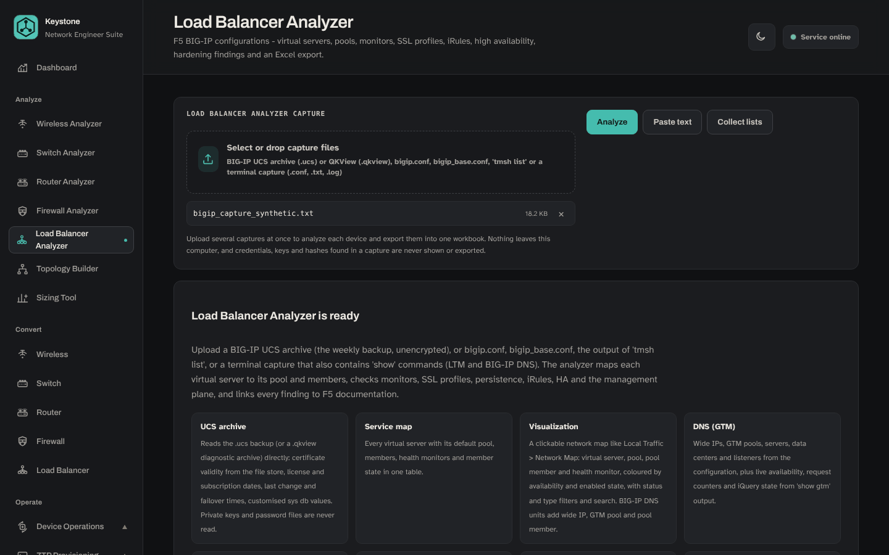

**Baca hasilnya.** **Overview** berisi platform dan rilis, virtual server (dan berapa yang publik atau disabled), pool dan member, profil SSL (dan berapa yang mengizinkan protokol atau cipher lama), sertifikat (dan mana yang kedaluwarsa, berapa hari lalu), state HA dan config-sync, paparan manajemen, serta jumlah temuan High dan Medium. Tab: **Visualization** (peta virtual server ke pool), **Virtual servers**, **Pools & nodes**, **Monitors**, **SSL & profiles**, **iRules & policies**, **Network**, **High availability**, **System**, **Hardening**, **Security**, **Inventory**, **Live state**, **Findings**, **Coverage**, **Collect**.

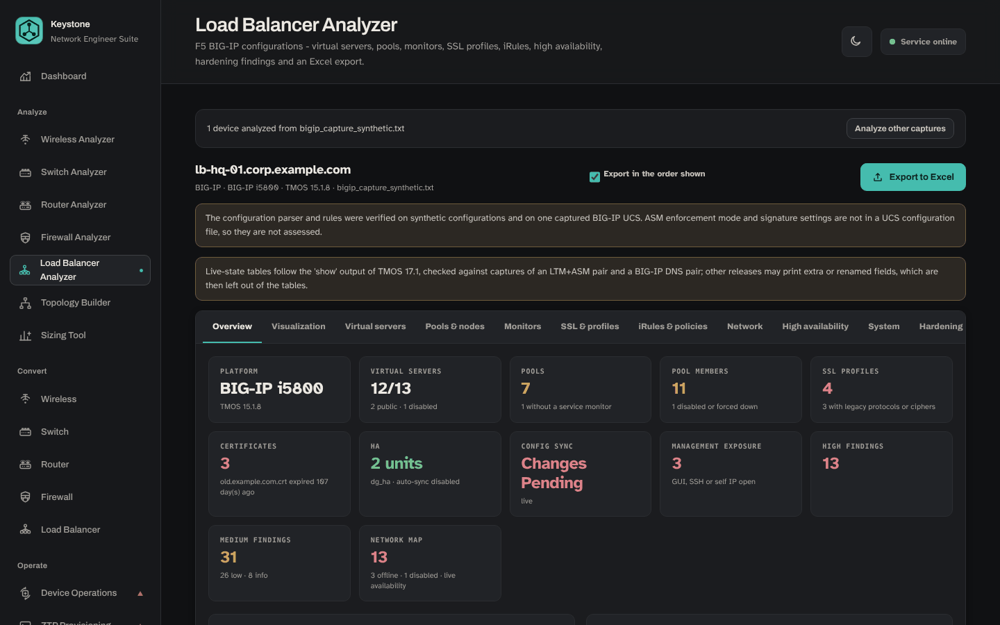

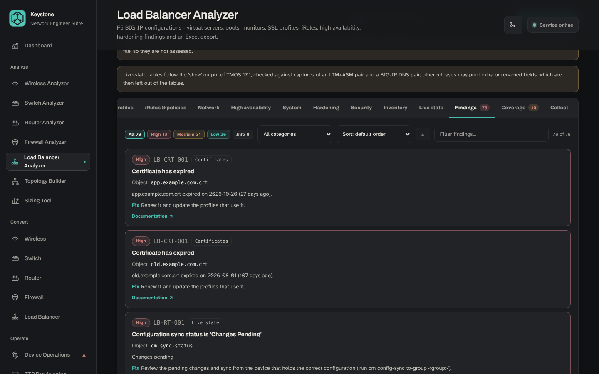

### Lebih dalam

- **Konfigurasi versus state live.** UCS memberi tahu apa yang dikonfigurasi; apakah member benar-benar up dan apakah pasangannya sinkron berasal dari output `tmsh show`. Tab **Live state** dan kartu "Changes Pending" muncul hanya kalau output itu diambil. Member offline serta "disabled" versus "forced down" dijelaskan di [LTM object status indicators](https://techdocs.f5.com/en-us/bigip-14-1-0/big-ip-tmos-routing-administration-14-1-0/dynamic-routing/about-route-health-injection/about-route-advertisement-of-virtual-addresses/ltm-object-status-indicators.html) F5.
- **Sertifikat dan waktu.** "Expired N days ago" dihitung dari tanggal hari ini, sehingga capture yang sama menghasilkan lebih banyak temuan bulan depan.
- **GTM / BIG-IP DNS**: wide IP, pool dan server dibaca dari daftar DNS (`collect-lb-f5-dns.txt`); rujukan objek: [gtm wideip](https://clouddocs.f5.com/cli/tmsh-reference/latest/modules/gtm/gtm_wideip_a.html).
- **vCMP dan partition.** Jalankan daftar di host dan di setiap guest yang Anda perhatikan; capture host vCMP menampilkan guest, bukan apa yang mereka publikasikan.
- Sebelum membagikan buffer, cari `password`, `secret`, `passphrase` dan `$M$` (nilai terenkripsi).

---

## 8. Topology Builder

**Menjawab:** bagaimana perangkat benar-benar dikabel. Tool menggambar jaringan dari neighbor CDP dan LLDP di capture Anda dan menghasilkan diagram draw.io, dengan nama port di setiap garis.

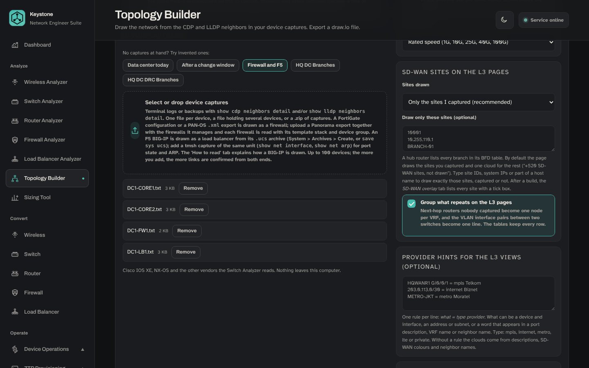

### Mulai di sini

**Apa yang diambil.** Satu capture per perangkat (atau ZIP). Tiap capture sebaiknya berisi `show cdp neighbors detail` dan `show lldp neighbors detail` (link), `show etherchannel summary` / `show port-channel summary` dan `show vpc` (bundle dan pasangan vPC), `show inventory` dan `show version` (model, serial, anggota stack), dan opsional `show mac address-table`, `show ip arp` dan `show ip interface brief` (host akhir dan link routed). Daftar collect Switch Analyzer sudah memuat sebagian besarnya, jadi capture untuk Switch Analyzer bisa dipakai di sini. FortiGate, Palo Alto, dan F5 BIG-IP (`.ucs`, ditambah capture `tmsh` dari unit yang sama untuk state port dan ARP) juga digambar. Makin banyak perangkat, makin banyak link yang terkonfirmasi dari **kedua** ujung.

**Jalankan.**

1. Buka **Topology Builder**. Belum punya capture? Tekan salah satu set rekaan (**Data center today**, **After a change window**, **Firewall and F5**, **HQ DC Branches**, **HQ DC DRC Branches**).
2. Opsional: ketik **Topology name**; semua unduhan lalu memakai nama itu.
3. Pakai opsi default untuk percobaan pertama. Tekan **Build topology**. Progress bar menampilkan langkah dan detik yang berjalan.

**Baca hasilnya.** Kartu menunjukkan berapa perangkat yang di-capture, berapa yang hanya terlihat oleh neighbor, jumlah link, berapa yang terkonfirmasi dari kedua ujung, berapa dari satu ujung, konflik, pasangan vPC dan temuan.

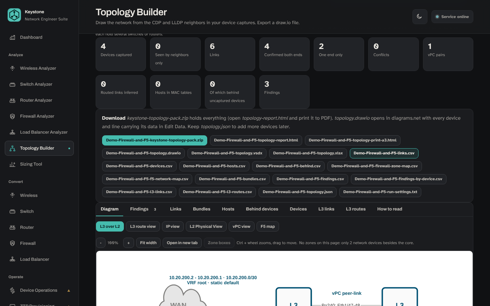

Tab **Diagram** menampilkan gambarnya. Pilih tampilan: **L3 over L2**, **L3 route view**, **IP view**, **L2 Physical View**, **vPC view** atau **F5 map**. Diagram bisa di-zoom, digeser, dibuka di tab baru, dan dipakai untuk melacak jalur hop demi hop.

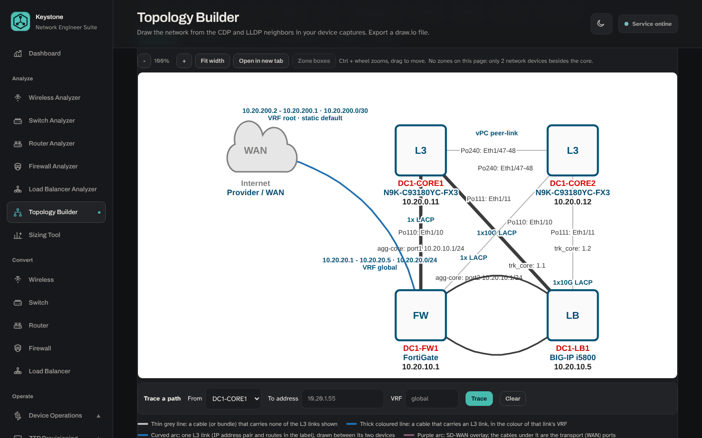

Unduh **pack** (`.zip`) untuk semuanya: file `.drawio` (buka di [diagrams.net / draw.io](https://www.drawio.com/)), laporan HTML yang bisa dicetak ke PDF, workbook Excel, dan tabel CSV untuk link, bundle, host, perangkat, temuan serta apa yang ada di balik perangkat yang tidak di-capture.

### Lebih dalam

- **Findings** (`TOPO-001` ...) menandai link yang dilaporkan satu ujung saja padahal peer-nya di-capture, port yang tidak cocok di kedua ujung, dua capture yang mengaku hostname sama, CDP dan LLDP yang berbeda, bundle yang satu ujungnya port-channel dan lainnya bukan, link antar-switch dalam state blocking spanning-tree, parameter MTU dan OSPF yang berbeda di kedua ujung, serta grup HSRP / VRRP yang dibandingkan antar perangkat. Tab **Capture next** mengurutkan perangkat yang capture-nya menambah paling banyak link terkonfirmasi, jadi Anda mengambil yang penting, bukan semuanya.
- **Kalau CDP / LLDP diam**, Keystone bisa menyimpulkan neighbor dari tabel ARP, lalu tabel MAC, lalu deskripsi port (berurutan menurut tingkat kepercayaan). Link hasil kesimpulan ditandai; matikan opsinya kalau Anda hanya ingin kabel yang terbukti. LLDP sendiri ditetapkan di [IEEE 802.1AB](https://1.ieee802.org/maintenance/p802-1ab-2016-revision-station-and-media-access-control-connectivity-discovery/).
- **Jaringan besar** dipecah menjadi satu halaman per site (**Grouping**: Automatic, satu diagram, satu sampai tiga kata pertama hostname, atau **Sites, smart**). Penempatan mengikuti peran yang ditemukan (core, distribution, access, firewall, load balancer, WAN) dan kabelnya, bukan namanya.
- **Pertahankan layout dan tambah perangkat nanti.** Pilih `topology.json` dari run sebelumnya di **Add to a previous run**, dan `.drawio` yang sudah Anda rapikan di **Keep my layout**. **Compare two runs** menunjukkan apa yang berubah setelah change window.
- **Access point controller** muncul di bawah port switch tempat mereka terpasang kalau capture controller mencantumkannya (Huawei `display ap lldp neighbor brief`) dan switch-nya juga di-capture.
- **Salinan anonim** mengganti hostname, domain, deskripsi, alamat IP dan MAC, serta serial dengan cara yang sama di mana-mana dan memberi file kunci; kirim salinannya ke vendor dan simpan kuncinya.
- Latar desain campus untuk membaca hasilnya: [Cisco Campus LAN and Wireless LAN design guide](https://www.cisco.com/c/en/us/td/docs/solutions/CVD/Campus/cisco-campus-lan-wlan-design-guide.html). Tiap opsi dan temuan didokumentasikan di [docs/modules/topology.md](modules/topology.md).

---

## 9. Sizing Tool

**Menjawab:** apa tepatnya yang saya punya, supaya saya bisa menghitung dan menawarkan penggantinya. Tool membuat satu inventaris semua access point, controller, switch, router, firewall dan load balancer dari campuran capture apa pun: hardware, modul, optik, lisensi, dan fitur yang dipakai, dikelompokkan per jenis perangkat.

### Mulai di sini

**Apa yang diambil.** Apa pun yang Anda punya, dari vendor mana pun: Cisco, Huawei, Aruba, FortiGate, Palo Alto, F5, MikroTik. Makin lengkap isi capture (`show version`, `show inventory`, output lisensi, transceiver, PoE), makin lengkap inventarisnya. Tool menyebut apa yang kurang di **Gaps and inputs** dan menawarkan daftar perintah read-only singkat per platform. Belum punya capture? Demo **Campus with wireless and licences** berisi sepuluh capture rekaan dari semua keluarga.

**Jalankan.**

1. Buka **Sizing Tool**. Ketik nama proyek dan **growth margin** (target = hari ini x (1 + pertumbuhan)).
2. Seret capture (jumlah berapa pun, ZIP boleh) atau tekan satu set demo.
3. Tekan **Build the sizing inventory**.

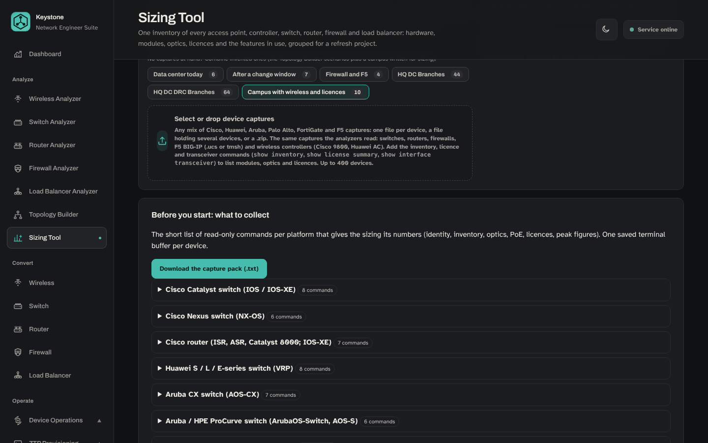

**Baca hasilnya.** Kartu menunjukkan perangkat, access point, controller, switch, router, firewall, load balancer, merek, site, berapa perangkat yang punya output lisensi, dan berapa lisensi yang berakhir dalam jendela yang Anda atur. Tab: **By device type** (model, jumlah, tier, redundansi, software), **Replacement plan**, **Bill of materials**, **Licences**, **Expiry**, **Peak figures**, **Features in use**, **Devices**, **Evidence**, **Sites**, **Imports**, **Compare**, **Gaps and inputs**.

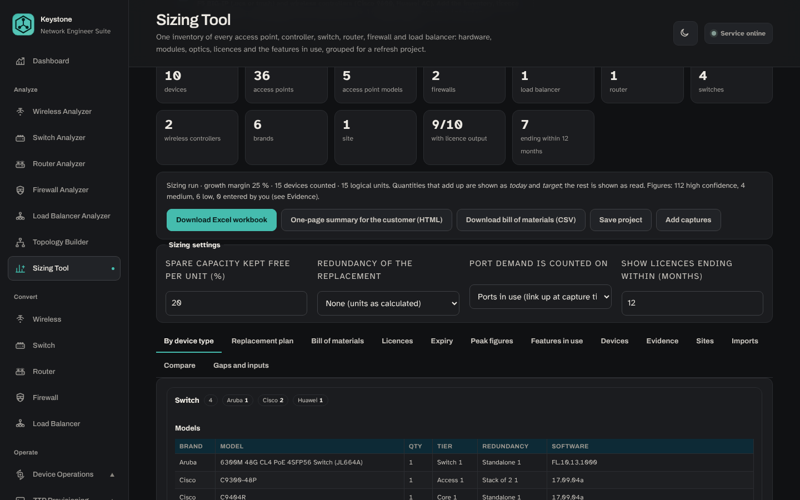

**Replacement plan** adalah tempat arsitek memutuskan. Untuk tiap grup (misalnya switch akses) ketik kapasitas **satu unit model yang Anda pertimbangkan** (dari datasheet) dan tool menghitung berapa unit yang dibutuhkan dari port, daya PoE dan optik hari ini, target setelah pertumbuhan, kapasitas cadangan yang Anda sisakan dan redundansi yang Anda pilih (none, N+1, 2N).

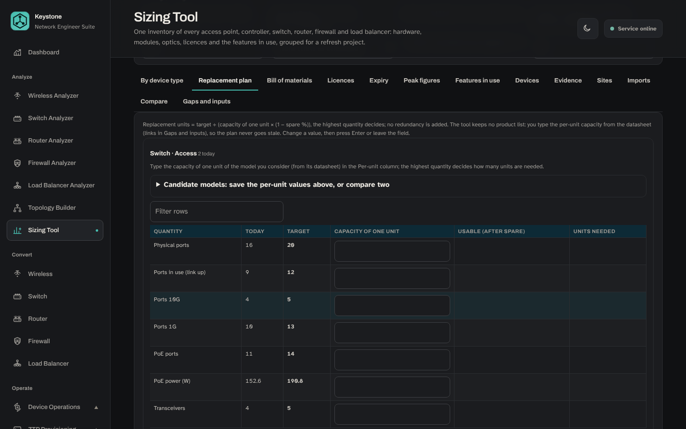

**Licences** menampilkan yang dipakai, dengan tier lisensi yang dibutuhkan penggantinya dan jendela perpanjangan yang bisa di-co-term.

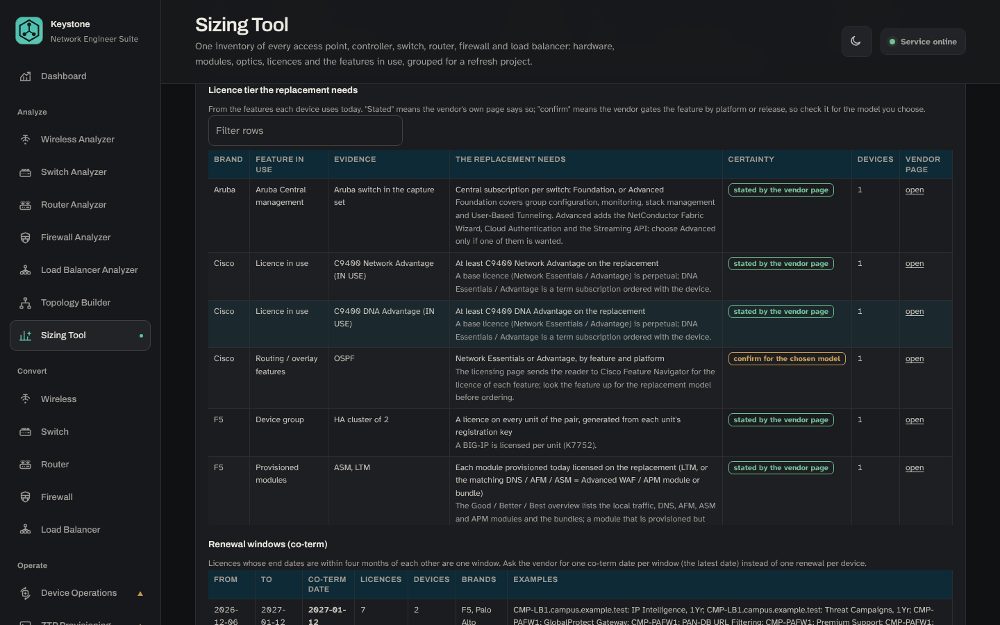

Ekspor **workbook Excel**, **bill of materials (CSV)** untuk tool penawaran, atau **ringkasan satu halaman** (HTML) untuk pelanggan. **Save project** menghasilkan file `.sizing.json` yang bisa dibuka lagi atau ditambah capture nanti.

### Lebih dalam

- **Tidak ada harga dan tidak ada katalog produk bawaan.** Anda mengetik sendiri kapasitas per unit, atau menyimpannya sebagai model kandidat di **candidate library** (ekspor dan impor sebagai JSON) dan membandingkan dua kandidat berdampingan. Dengan begitu angkanya milik Anda dan bisa diaudit.
- **Evidence.** Tiap angka membawa sumber dan tingkat keyakinan (high, medium, low, entered). Capture yang tidak menyebut sebuah angka tidak diberi tebakan; Anda mengetiknya dan ditandai "entered".
- **Capture parsial satu perangkat digabung** (serial sama, atau hostname dan jenis sama), bukan salah satunya dibuang, dan sumbernya dicantumkan. **Pasangan redundan** (Cisco vPC, Huawei M-LAG dan VRRP hot standby, Aruba VSX, FortiGate FGCP, Palo Alto active/passive, Cisco ASA failover, Catalyst 9800 HA SSO, F5 device group) ditemukan dari **konfigurasi** (alamat peer yang saling cermin, ID domain atau group, tabel neighbor), bukan dari hostname, dan dihitung sebagai satu unit logis. Stack atau pasangan StackWise Virtual sudah satu perangkat. Kalau hanya satu anggota pasangan yang di-capture, pasangannya ditandai. Latar: [FortiGate FGCP](https://docs.fortinet.com/document/fortigate/8.0.0/administration-guide/62403/fgcp), [Palo Alto active/passive HA](https://docs.paloaltonetworks.com/pan-os/10-0/pan-os-admin/high-availability/set-up-activepassive-ha/configure-activepassive-ha), [Cisco vPC](https://www.cisco.com/c/en/us/support/docs/switches/nexus-9000-series-switches/218333-understand-and-configure-nexus-9000-vpc.html).
- **Firewall dihitung dengan angka throughput yang tepat.** Dari rule yang dipakai (firewall biasa, application control, threat prevention, decryption) tool memilih kolom datasheet yang cocok, dan plan menunjukkan angka mana yang dipakai. Datasheet misalnya [Palo Alto PA-3400 series](https://paloaltonetworks.com/resources/datasheets/pa-3400-series) dan [Cisco Secure Firewall 3100 series](https://www.cisco.com/c/en/us/products/collateral/security/firewalls/secure-firewall-3100-series-ds.html).
- **Tier lisensi.** Fitur yang ditemukan di konfigurasi dipetakan ke tier yang dibutuhkan pengganti, ditandai **stated** (capture membuktikannya) atau **confirm** (harus dicek orang). Rujukan lisensi: [matriks DNA subscription Cisco untuk switching](https://www.cisco.com/c/m/en_us/products/software/dna-subscription-switching/en-sw-sub-matrix-switching.html), [FortiGate security bundles](https://www.fortinet.com/support/support-services/fortiguard-security-subscriptions/fortigate-security-bundles), [lisensi Palo Alto](https://docs.paloaltonetworks.com/resources/licensing-registration-activation), [F5 good-better-best](https://www.f5.com/pdf/licensing/good-better-best-licensing-overview.pdf).
- **Imports** menerima peta site Anda, angka puncak hasil ukur, entitlement lisensi yang diekspor dari portal vendor (Cisco Smart Account / SNTC, FortiCare, Aruba Central / GreenLake, Palo Alto CSP) dan tabel lifecycle tanggal end-of-sale. Daftar end-of-life Cisco: [products EOS / EOL](https://www.cisco.com/c/en/us/products/eos-eol-listing.html).
- **Compare** dua run tersimpan untuk melihat apa yang berubah antara dua survei. Deskripsi lengkap tiap opsi: [docs/modules/sizing-tool.md](modules/sizing-tool.md).

---

## 10. Satu capture, beberapa tool

File yang sama bisa dipakai lebih dari satu tool; Anda tidak perlu mengambil dua kali.

| Capture | Wireless | Switch | Router | Firewall | Load Balancer | Topology | Sizing |
| --- | :-: | :-: | :-: | :-: | :-: | :-: | :-: |
| Cisco 9800 `show tech-support wireless` | ya | | | | | | ya |
| Huawei AC `display current-configuration` + tabel runtime | ya | | | | | link ke switch | ya |
| Daftar collect switch Catalyst / Nexus / Huawei / Aruba | | ya | | | | ya | ya |
| Daftar collect router Cisco IOS-XE / SD-WAN | | | ya | | | ya | ya |
| FortiGate / Palo Alto / MikroTik | | | | ya | | ya (FortiGate, Palo Alto) | ya |
| F5 `.ucs` atau `tmsh` | | | | | ya | ya | ya |

File yang dikirim ke analyzer yang salah tidak dipaksa lewat parser yang salah: halaman memberi tahu analyzer mana yang harus dipakai.

---

## 11. Istilah yang akan Anda temui

- **Capture**: teks yang Anda simpan dari sesi terminal (perintah dan outputnya).
- **CDP / LLDP**: protokol tempat perangkat memperkenalkan diri ke tetangganya (nama, port, model). CDP milik Cisco, LLDP standar ([IEEE 802.1AB](https://1.ieee802.org/maintenance/p802-1ab-2016-revision-station-and-media-access-control-connectivity-discovery/)). Dari sinilah Keystone tahu siapa terhubung ke siapa.
- **Port-channel / LACP**: beberapa kabel digabung menjadi satu link logis.
- **vPC / M-LAG / VSX / VSS / SVL**: dua switch yang bertindak sebagai satu bagi perangkat di bawahnya. Nama vendor untuk gagasan yang sama.
- **HA (high availability)**: dua unit, satu aktif dan satu standby (atau keduanya aktif).
- **HSRP / VRRP**: alamat gateway virtual yang dipakai bersama dua router ([VRRP adalah RFC 5798](https://www.rfc-editor.org/rfc/rfc5798)).
- **Hardening**: mematikan yang tidak dibutuhkan dan melindungi yang dipakai (akses manajemen, logging, autentikasi).
- **Finding (temuan)**: sesuatu yang ditemukan Keystone dan perlu Anda lihat, dengan tingkat keparahan (High, Medium, Low, Info).
- **UCS**: arsip F5 BIG-IP dari sebuah unit.
- **N+1**: satu unit cadangan lebih banyak dari kebutuhan beban.

---

## 12. Kalau ada yang tidak jalan

| Yang Anda lihat | Yang dilakukan |
| --- | --- |
| "File not recognised" atau halaman menyebut analyzer lain | Pakai analyzer yang disebut, atau ambil ulang dengan daftar dari tab **Collect** tool yang tepat. |
| Tabel kosong | Buka **Coverage**: perintahnya tidak ada di file Anda, atau ditolak perangkat. Ambil daftar lengkap. |
| Capture berhenti di tengah | Buffer terminal terlalu pendek. Perbesar scrollback tool terminal Anda (MobaXterm, PuTTY, SecureCRT) atau simpan sesi ke file log. |
| `--More--` di capture | Matikan paging untuk sesi Anda (`terminal length 0`, `screen-length 0 temporary`, `no page`, `set cli pager off`). |
| Topology menampilkan sedikit link | Tambah capture perangkat tetangga, dan pastikan LLDP aktif di interface. Lihat **Capture next**. |
| Angka Sizing Tool tampak rendah | Buka **Gaps and inputs**; ketik angka yang kurang (ditandai "entered") atau tambah capture dengan output lisensi dan transceiver. |
| Lainnya | Tabel masalah umum di [PANDUAN.md](PANDUAN.md#10-masalah-umum). |

---

## 13. Dokumentasi rujukan

Semua tautan di bawah adalah dokumentasi resmi vendor.

**Cisco**

- [Catalyst 9800 command reference: show commands](https://www.cisco.com/c/en/us/td/docs/wireless/controller/9800/command-reference/b_wireless_cr/show-commands.html)
- [Troubleshoot Catalyst 9800 AP join or disconnection](https://www.cisco.com/c/en/us/support/docs/wireless/catalyst-9800-series-wireless-controllers/218396-troubleshoot-catalyst-9800-ap-join-or-di.html)
- [Catalyst 9300 spanning tree (17.12)](https://www.cisco.com/c/en/us/td/docs/switches/lan/catalyst9300/software/release/17-12/configuration_guide/lyr2/b_1712_lyr2_9300_cg/configuring_spanning_tree_protocol.html)
- [Nexus 9000 vPC](https://www.cisco.com/c/en/us/support/docs/switches/nexus-9000-series-switches/218333-understand-and-configure-nexus-9000-vpc.html)
- [Troubleshooting LACP](https://www.cisco.com/c/en/us/support/docs/lan-switching/link-aggregation-control-protocol-lacp-8023ad/221051-troubleshoot-link-aggregation-control-pr.html)
- [IOS XE configuration guides](https://www.cisco.com/c/en/us/td/docs/ios-xml/ios/)
- [Catalyst SD-WAN design guide](https://www.cisco.com/c/en/us/td/docs/solutions/CVD/SDWAN/cisco-sdwan-design-guide.html)
- [Campus LAN and WLAN design guide](https://www.cisco.com/c/en/us/td/docs/solutions/CVD/Campus/cisco-campus-lan-wlan-design-guide.html)

**Huawei**

- [WLAN AC V200R019C00 command reference: display ap](https://support.huawei.com/enterprise/en/doc/EDOC1100096312/159f8860/display-ap)

**Aruba (HPE)**

- [AOS-CX 10.13: show lldp neighbor-info](https://arubanetworking.hpe.com/techdocs/AOS-CX/10.13/HTML/fundamentals_8400/Content/Chp_Dev_disc/LLDP_cmds/sho-lld-nei-inf-10.htm)

**Fortinet**

- [FortiOS CLI reference](https://docs.fortinet.com/document/fortigate/7.6.6/cli-reference/84566/fortios-cli-reference)
- [FGCP high availability](https://docs.fortinet.com/document/fortigate/8.0.0/administration-guide/62403/fgcp)

**Palo Alto Networks**

- [PAN-OS CLI cheat sheet](https://docs.paloaltonetworks.com/ngfw/pan-os-cli-quick-start/cli-cheat-sheet-device-management)
- [Security policy best practices](https://docs.paloaltonetworks.com/best-practices/security-policy-best-practices/security-policy-best-practices/deploy-security-policy-best-practices)
- [Hirarki rule Panorama](https://docs.paloaltonetworks.com/panorama/administration/manage-firewalls/manage-device-groups/manage-the-rule-hierarchy)

**F5**

- [BIG-IP archives (UCS)](https://techdocs.f5.com/en-us/bigip-14-1-0/big-ip-system-essentials-14-1-0/archives.html)
- [tmsh reference: sys ha-status](https://clouddocs.f5.com/cli/tmsh-reference/latest/modules/sys/sys_ha-status.html)
- [LTM object status indicators](https://techdocs.f5.com/en-us/bigip-14-1-0/big-ip-tmos-routing-administration-14-1-0/dynamic-routing/about-route-health-injection/about-route-advertisement-of-virtual-addresses/ltm-object-status-indicators.html)

**Standar dan alat**

- [IEEE 802.1AB (LLDP)](https://1.ieee802.org/maintenance/p802-1ab-2016-revision-station-and-media-access-control-connectivity-discovery/)
- [RFC 5798 (VRRP)](https://www.rfc-editor.org/rfc/rfc5798)
- [diagrams.net / draw.io](https://www.drawio.com/)

Detail modul di dalam repository ini: [docs/modules/wireless.md](modules/wireless.md), [docs/modules/topology.md](modules/topology.md), [docs/modules/sizing-tool.md](modules/sizing-tool.md), [docs/modules/panorama.md](modules/panorama.md), [docs/modules/switch-analyzer-baseline.md](modules/switch-analyzer-baseline.md).
