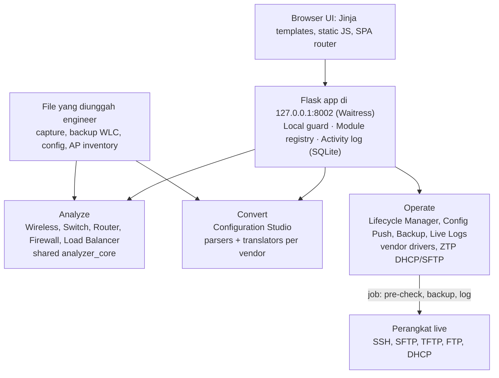
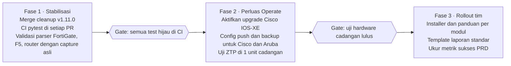

# Keystone PRD

15 Oktober 2026 · Aldi

> Salinan di repo dari dokumen PRD bersama. Jika ada perbedaan, versi dokumen bersama yang berlaku; perbarui file ini setiap rilis.

## Ringkasan

Keystone adalah workspace lokal untuk engineer jaringan: satu aplikasi web di laptop engineer yang menggabungkan assessment, migrasi konfigurasi, dan operasi lifecycle perangkat multi-vendor. Semua data konfigurasi diproses di mesin engineer, tidak dikirim ke layanan eksternal.

Per Oktober 2026, Keystone berada di versi 1.11.0 dengan 8 modul aktif (11 tool di dashboard), sekitar 105 ribu baris kode Python, dan 2.109 automated test yang semuanya lulus. Modul write-to-device (firmware upgrade paralel) sudah diuji end-to-end di switch Huawei S5735 produksi.

Dokumen ini mengunci scope produk, batas aman fitur yang menyentuh perangkat produksi, dan roadmap, supaya pengembangan berikutnya bisa dibagi ke lebih dari satu engineer.

## Masalah dan latar belakang

Pekerjaan postsales dan assessment jaringan hari ini tersebar di banyak alat terpisah: terminal, spreadsheet manual, script pribadi, dan GUI vendor yang berbeda-beda. Akibatnya hasil kerja tergantung siapa engineernya.

- **Assessment lambat dan tidak seragam.** Membaca running-config, tech-support, atau backup WLC lalu menyusunnya ke Excel memakan berjam-jam per perangkat, dan format laporan beda tiap engineer.
- **Migrasi rawan salah ketik.** Konversi konfigurasi antar vendor (misalnya Cisco ke Huawei, MikroTik ke Palo Alto) masih dikerjakan manual baris per baris.
- **Operasi massal berisiko.** Upgrade firmware dan push config ke puluhan switch sekaligus butuh pre-check, backup, dan log yang konsisten. Tanpa itu, satu kesalahan bisa memutus site.
- **Data pelanggan sensitif.** Konfigurasi berisi credential dan topologi. Mengunggahnya ke layanan cloud pihak ketiga tidak bisa diterima.

Keystone menjawab keempatnya dengan satu aplikasi lokal yang menghasilkan output seragam: laporan Excel, config hasil konversi, dan audit log per job.

## Target user

| Persona | Kebutuhan utama | Yang diharapkan dari Keystone |
| --- | --- | --- |
| Engineer senior | Kecepatan dan kepadatan informasi saat change window | Analisa langsung dari capture, filter cepat, kontrol penuh atas job massal |
| Engineer junior | Tahu tool mana yang dipakai dan input apa yang dibutuhkan | Panduan singkat per modul, collect script siap pakai, istilah vendor yang konsisten |
| PM dan manager | Bukti kerja yang bisa dibaca tanpa membuka CLI | Laporan Excel seragam, status job, riwayat backup per perangkat |

Konteks pemakaian: staging switch, wireless assessment, migrasi konfigurasi, pre-check, dan persiapan firmware. Engineer biasanya membuka Keystone berdampingan dengan terminal, console, dan dokumen change.

## Tujuan, metrik sukses, dan non-goals

**Tujuan**

1. Engineer yang belum pernah memakai Keystone bisa menyelesaikan satu assessment dan mengekspor hasilnya tanpa dibriefing.
2. Semua laporan assessment punya struktur yang sama, apapun vendornya.
3. Setiap aksi yang menulis ke perangkat produksi selalu melewati pre-check, backup, dan tercatat di log.
4. Data pelanggan tidak pernah keluar dari laptop engineer.

**Metrik sukses** (target diusulkan, perlu disepakati tim)

| Metrik | Cara ukur | Target |
| --- | --- | --- |
| Waktu assessment satu perangkat | Upload capture sampai Excel terunduh | Di bawah 10 menit |
| Job write-to-device tanpa backup | Hitung dari job store | 0 |
| Automated test yang lulus di branch utama | `pytest` | 100% sebelum rilis |
| Engineer aktif di tim | Jumlah instalasi yang dipakai minimal sekali seminggu | Diisi setelah rollout tim |

**Non-goals**

- Bukan NMS atau monitoring 24/7. Keystone dijalankan saat dibutuhkan, bukan sebagai server permanen.
- Bukan aplikasi multi-user terpusat. Satu instalasi untuk satu engineer.
- Tidak menggantikan GUI atau controller vendor (DNA Center, iMaster NCE, Panorama).
- Tidak menghapus konfigurasi di perangkat secara otomatis. Objek yang hanya ada di target selalu jadi report-only.

## Peta modul

Keystone terdiri dari 8 modul dalam tiga kelompok kerja: **Analyze** (baca dan nilai kondisi perangkat), **Convert** (siapkan konfigurasi baru), dan **Operate** (eksekusi ke perangkat). Daftar resminya ada di `core/modules.py`.

| Modul | Kelompok | Input | Output | Use case utama |
| --- | --- | --- | --- | --- |
| Wireless Analyzer | Analyze | Backup WLC Huawei / Cisco 9800, AP inventory CSV/XLSX | Dashboard, Excel assessment, Config Delta, AP Role Diff, As-built | Assessment wireless, validasi AP master, perbandingan controller TTC/HO |
| Switch Analyzer | Analyze | Running-config atau terminal capture | Health findings, sizing, compare dua capture, Excel | Pre-check dan post-check switch, assessment campus |
| Router Analyzer | Analyze | Terminal capture atau show tech-support | Findings routing, BGP/OSPF, VPN, NAT, SD-WAN | Health check router dan overlay SD-WAN |
| Firewall Analyzer | Analyze | Config atau capture firewall | Findings policy, NAT, VPN, profile, Excel | Review policy dan hardening firewall |
| Load Balancer Analyzer | Analyze | Capture tmsh atau arsip UCS | Findings LTM, GTM, SSL, HA, sertifikat | Review virtual server, pool, dan masa berlaku sertifikat |
| Topology Builder | Analyze | Capture per perangkat atau ZIP (CDP/LLDP, opsional MAC/ARP) | Diagram draw.io (layout dipertahankan), Excel, tabel link dan host, port-channel, pasangan vPC (tampilan vPC), kecepatan link, paket dokumentasi, gabung hasil sebelumnya, link routed | Membuat diagram jaringan dari backup tanpa menggambar manual |
| Convert (Configuration Studio) | Convert | Running-config sumber + mapping inventory | Config target, preview mapping, batch export | Migrasi antar vendor. Lima halaman per jenis perangkat; saat ini hanya Switch dan Firewall yang punya converter |
| Lifecycle Manager | Operate | Range IP, credential, firmware image, draft config | Inventaris perangkat, job upgrade, push, backup, Live Logs | Discovery, firmware upgrade massal, config push, config backup |
| ZTP Provisioning | Operate | Daftar ESN dan parameter manajemen | File intermediate `.ini`, bootstrap config, layanan SFTP/DHCP | Onboarding switch Huawei factory-default tanpa console |

Semua analyzer memakai inti yang sama (`analyzer_core`) untuk format hasil, severity finding, redaksi data sensitif, dan export. Ini yang menjamin laporan dari vendor berbeda tetap seragam.

Setiap analyzer disertai **collect script** per platform (12 script saat ini) supaya engineer tahu persis command apa yang harus dijalankan sebelum upload.

## Vendor x capability matrix

Huawei VRP adalah satu-satunya platform dengan dukungan penuh dari analisa sampai eksekusi. Vendor lain saat ini kuat di sisi analisa dan konversi, sementara operasi write-to-device masih dikunci ke Huawei.

| Platform | Analyzer | Configuration Studio | Discovery | Firmware upgrade | Config push dan backup | ZTP |
| --- | --- | --- | --- | --- | --- | --- |
| Huawei VRP switch (S/L/E series) | Switch | Sumber dan target | Ya | Ya, live-tested S5735 | Ya | Ya, belum divalidasi hardware |
| Huawei WLC (AC6508, 9700) | Wireless | Tidak | Tidak | Tidak | Tidak | Tidak |
| Cisco Catalyst (IOS, IOS-XE switch) | Switch | Sumber dan target | Ya | Driver ada, belum diaktifkan | Belum | Tidak |
| Cisco Nexus (NX-OS) | Switch, termasuk vPC dan HSRP | Tidak | Ya | Driver ada, belum diaktifkan | Belum | Tidak |
| Cisco Catalyst 9800 WLC | Wireless | Tidak | Tidak | Tidak | Tidak | Tidak |
| Cisco IOS-XE router dan SD-WAN | Router | Tidak | Ya | Belum | Belum | Tidak |
| Aruba AOS-Switch dan AOS-CX | Switch | Sumber dan target | Ya | Belum | Belum | Tidak |
| Fortinet FortiGate | Firewall, parser native | Tidak | Tidak | Tidak | Tidak | Tidak |
| Palo Alto PAN-OS | Firewall | Target (dari MikroTik) | Tidak | Tidak | Tidak | Tidak |
| MikroTik RouterOS | Firewall | Sumber (ke Palo Alto) | Tidak | Tidak | Tidak | Tidak |
| F5 BIG-IP | Load Balancer, termasuk UCS | Tidak | Tidak | Tidak | Tidak | Tidak |

"Driver ada, belum diaktifkan" berarti kode `install_firmware` untuk platform tersebut sudah ditulis, tetapi engine upgrade menolak menjalankannya di mode real sampai divalidasi di hardware. Demo Mode tetap bisa mensimulasikan semua platform.

## Klasifikasi risiko dan safeguard wajib

Setiap fitur masuk satu dari tiga kelas risiko. Fitur baru tidak boleh dirilis sebelum memenuhi semua safeguard di kelasnya. Kelas ini juga tampil sebagai label di dashboard (`Offline`, `Read-only`, `Writes to devices`).

| Kelas | Fitur | Dampak terburuk | Safeguard wajib |
| --- | --- | --- | --- |
| R0: offline | Semua analyzer, Configuration Studio, Config Delta, AP Role Diff | Laporan salah, config hasil konversi salah | Credential di-mask di UI dan export; objek target-only selalu report-only; output konversi wajib di-review manusia sebelum dipakai |
| R1: read-only ke perangkat | Discovery, Config Backup, Device Reachability | Akun terkunci atau IP sumber di-blacklist perangkat | Satu koneksi SSH per IP tanpa pre-probe; hanya command baca; satu command gagal tidak menghentikan batch |
| R2: write ke perangkat | Firmware Upgrade, Config Push, ZTP DHCP/SFTP | Site putus, perangkat gagal boot, DHCP liar di jaringan produksi | Pre-check sebelum start; backup otomatis sebelum dan sesudah; Demo Mode untuk gladi; push berhenti di baris pertama yang ditolak; DHCP menolak bind ke semua interface dan butuh konfirmasi segmen terisolasi; semua langkah tercatat di Live Logs |

**Aturan lintas kelas**

- Server default hanya bind ke `127.0.0.1`. Akses remote harus diaktifkan eksplisit lewat `NES_ALLOW_REMOTE`.
- Tidak ada login. Karena server hanya bind ke `127.0.0.1`, hanya program di komputer yang sama yang bisa terhubung. `core/local_guard.py` menjawab hanya nama host milik komputer itu (`localhost`, `127.0.0.1`, `[::1]`) dan menolak POST/PUT/PATCH/DELETE yang dimulai website lain (cek `Host`, `Origin`, dan `Sec-Fetch-Site`), sehingga DNS rebinding dan CSRF dari browser tidak bisa menjalankan tool.
- Platform baru masuk kelas R2 hanya setelah satu kali uji end-to-end di hardware cadangan, dicatat di bagian status validasi.

## Kebutuhan non-fungsional

| Area | Kebutuhan |
| --- | --- |
| Local-first | Berjalan penuh tanpa internet. Font, ikon, dan library UI dibundel lokal, tanpa CDN. |
| Platform | Windows, macOS, dan Linux dengan Python 3. Satu klik: `start_*` memasang dirinya sendiri pada start pertama (`setup_*` untuk pasang ulang, `stop_*` untuk berhenti). |
| Data handling | Data runtime (credential, secret key, backup, firmware) tidak pernah masuk git. File export dan upload lebih dari 30 hari dibersihkan otomatis saat startup. |
| Keamanan | Tanpa login, hanya lokal. Secret key dibuat acak saat instalasi pertama. Credential perangkat tidak ditampilkan ulang di log maupun export. |
| Keandalan | Satu command atau satu perangkat yang gagal tidak menghentikan job batch. Error ditampilkan per perangkat, bukan sebagai crash halaman. |
| Performa | Analisa satu capture selesai dalam hitungan detik di laptop standar. Upgrade paralel beberapa perangkat dalam satu job. |
| Aksesibilitas | Navigasi keyboard, focus state terlihat, kontras WCAG AA, dukungan reduced motion. Status tidak hanya dibedakan dengan warna. |
| Konsistensi istilah | Istilah vendor (VAP, eth-trunk, vPC, port-channel) dipertahankan apa adanya, tidak diterjemahkan. |

## Arsitektur dan quality baseline

Keystone adalah satu aplikasi Flask yang dijalankan di laptop engineer. Modul Analyze dan Convert hanya membaca file yang diunggah; hanya modul Operate yang membuka sesi ke perangkat.

Satu registry (`core/modules.py`) menentukan nama, grup, kelas risiko, dan versi setiap tool. Dashboard, sidebar, quick guide, dan `/api/health` membaca dari sana, jadi menambah modul cukup di satu tempat.

| Baseline per 15 Okt 2026 | Nilai |
| --- | --- |
| Kode Python | 105.351 baris |
| Automated test | 2.109 lulus, 2 di-skip, 0 gagal (85 file test) |
| Capture asli sebagai fixture | 77 file, sudah di-mask |
| Collect script | 12 platform |
| Dependensi runtime | Flask, Waitress, openpyxl, Netmiko, Paramiko, scp, pyftpdlib, psutil |

**Definition of done untuk perubahan apapun:** semua test lulus, collect script sinkron dengan command yang dibaca parser, istilah vendor dipertahankan, dan fitur kelas R2 punya pre-check, backup, serta Demo Mode.

## Status validasi dan known limitations

Parser dan driver dianggap tervalidasi setelah dijalankan pada capture atau hardware asli. Saat ini ada 77 capture asli (sudah di-mask) dari Huawei S5735/S5755, Cisco 2960 sampai 9300X, Nexus 9000, Aruba 2540, dan AOS-CX yang menjadi fixture test.

| Area | Status | Catatan |
| --- | --- | --- |
| Firmware upgrade Huawei VRP | Tervalidasi | End-to-end di S5735 produksi, termasuk upgrade paralel beberapa perangkat |
| Switch Analyzer Huawei, Cisco, Aruba, NX-OS | Tervalidasi | Fixture dari capture asli |
| Router Analyzer Cisco IOS-XE | Sebagian | `show ip eigrp neighbors`, `show standby brief`, `show vrrp brief` belum pernah terlihat dengan data asli |
| Firewall Analyzer FortiGate | Sebagian | Parser routing table, BGP summary, IPsec tunnel summary, dan HA status ditulis dari dokumentasi Fortinet, belum dari capture asli |
| Load Balancer Analyzer F5 | Sebagian | Output `show sys version`, sync, failover, virtual, dan pool belum diuji dengan capture asli |
| ZTP Huawei | Belum | Perilaku `rsa local-key-pair create` dari startup-config batch dan pembacaan DHCP Option 67 belum diuji di hardware |
| Upgrade, push, backup non-Huawei | Belum | Dikunci di engine sampai ada uji hardware |

**Known limitations**

- Configuration Studio untuk firewall hanya mendukung arah MikroTik ke Palo Alto.
- Convert Wireless, Router, dan Load Balancer belum punya converter. Halamannya menolak konversi dan menunjuk ke analyzer yang sesuai.
- Status online hasil discovery adalah snapshot tanpa timestamp. Gunakan Device Reachability untuk status terkini.
- DHCP bawaan ZTP membutuhkan `dnsmasq` yang diinstal terpisah.
- Satu instalasi untuk satu engineer. Belum ada sinkronisasi data antar laptop.

## Roadmap dan open questions

Roadmap ini usulan urutan, belum dengan tanggal. Fase 1 sedang berjalan; perluasan write-to-device ke vendor lain hanya dibuka setelah lolos uji hardware.

**Open questions untuk tim dan manager**

- [ ] Apakah Keystone dipakai resmi oleh tim postsales, atau tetap tool internal engineer?
- [ ] Siapa owner per modul setelah rollout, dan siapa yang approve rilis?
- [ ] Vendor mana yang diprioritaskan untuk Fase 2: Cisco IOS-XE atau Aruba?
- [ ] Apakah tersedia perangkat cadangan untuk uji upgrade dan ZTP non-produksi?
- [ ] Apakah laporan Excel perlu template dengan identitas perusahaan untuk diserahkan ke pelanggan?
- [ ] Target angka untuk metrik sukses di bagian Tujuan.
