# Keystone tools guide: the seven Analyze tools

This page explains what each Analyze tool does, which commands to capture, how to run it, and how to read the result. It is written twice over on purpose: the **Start here** parts are for someone who has never opened Keystone, and the **Going deeper** parts are for an engineer who already knows the platform and wants to know what the tool does with it. Bahasa Indonesia: [PANDUAN_ALAT.md](PANDUAN_ALAT.md). Install and first start: [README.md](../README.md).

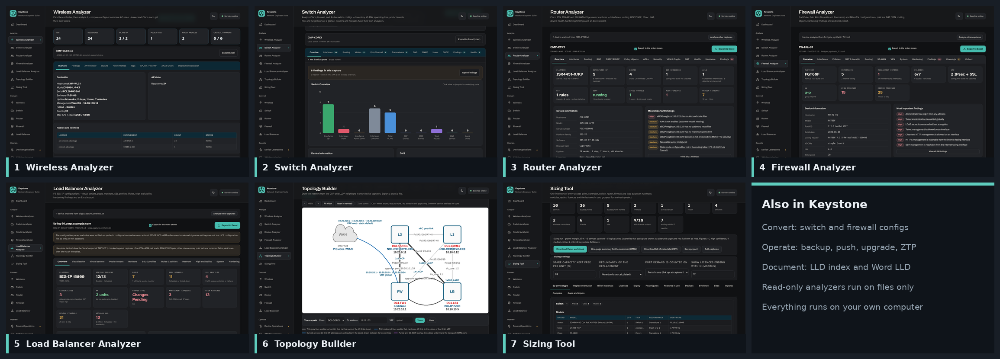

All pictures and the recording on this page use **invented** captures (names such as `CMP-CORE1`, addresses from documentation ranges). No customer data is in this repository.

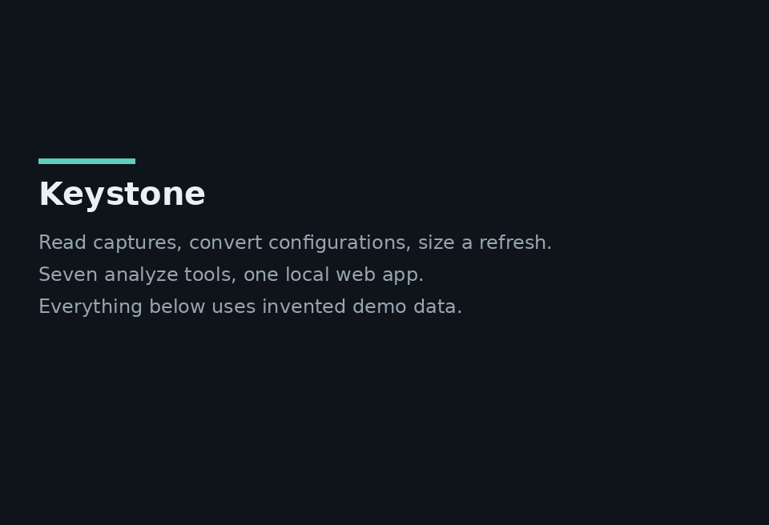

**On this page**

1. [How every Analyze tool works](#1-how-every-analyze-tool-works)
2. [Which tool do I open?](#2-which-tool-do-i-open)
3. [Wireless Analyzer](#3-wireless-analyzer)
4. [Switch Analyzer](#4-switch-analyzer)
5. [Router Analyzer](#5-router-analyzer)
6. [Firewall Analyzer](#6-firewall-analyzer)
7. [Load Balancer Analyzer](#7-load-balancer-analyzer)
8. [Topology Builder](#8-topology-builder)
9. [Sizing Tool](#9-sizing-tool)
10. [One capture, several tools](#10-one-capture-several-tools)
11. [Words you will see](#11-words-you-will-see)
12. [When something does not work](#12-when-something-does-not-work)
13. [Reference documentation](#13-reference-documentation)

---

## 1. How every Analyze tool works

### Start here

An Analyze tool never connects to your network. You collect the output of some `show` (or `display`, `get`, `tmsh`) commands yourself, save it as a text file, and give that file to Keystone. Keystone reads the text, builds tables and a list of findings, and lets you download an Excel report. Everything runs on your own computer.

The same four steps apply to the five analyzers (Wireless, Switch, Router, Firewall, Load Balancer):

1. **Collect.** Open the tool, open its **Collect Backup** tab (or **Collect lists** / **Commands to capture** button) and take the command list for your platform. Copy the commands, paste them into your SSH or console session, and save the **whole** terminal output as one `.txt` file. A terminal log is fine: the prompts and the commands you typed are part of what Keystone uses to find where each output starts.
2. **Upload.** Drop the file on the page. Leave the vendor on **Auto Detect** unless the page asks you to pick the controller first (Wireless). Several files, or a ZIP, can go in together; each file is read as one device.
3. **Read.** Start at **Overview**, then **Findings**. Each finding has a severity, the object it is about, why it matters, the fix, and a link to the vendor documentation.
4. **Export.** **Export to Excel** gives a workbook with every table, the findings, and a coverage sheet that says which commands were found in your file.

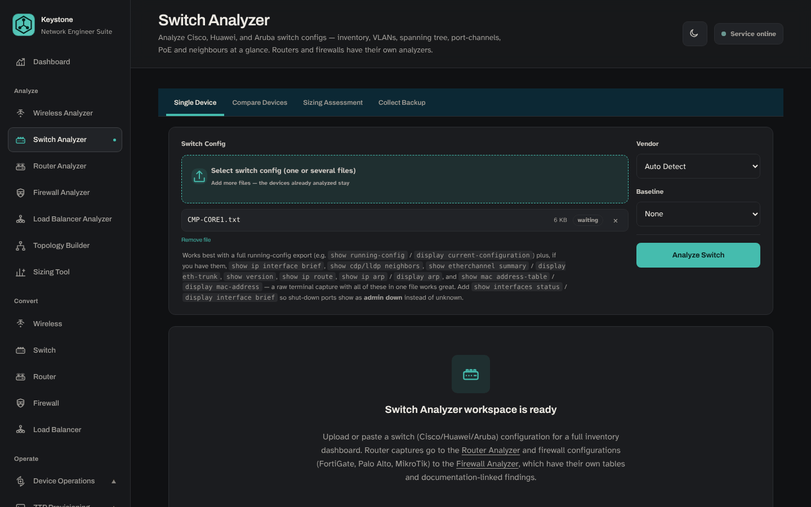

> **Safety notes for the collect lists**
>
> - Use a **read-only** account. Every command in the lists only reads, with one exception: the first line of the Cisco, Huawei and Aruba switch lists and of the IOS-XE router list is `write memory` (Huawei: `save`, then `y`). It saves the running configuration to startup so that the backup you are about to take equals what the device boots with. If you must not change anything on the device, delete that line before you paste the list.
> - `terminal length 0` (or `screen-length 0 temporary`, `no page`, `set cli pager off`) only changes the paging of your own session.
> - The output can contain community strings, hashes and keys. Keystone processes it locally and does not send it anywhere, but a capture you e-mail to someone else carries those secrets. Search for `password`, `secret`, `community` and `$M$` before you share a file.

### Going deeper

- **Coverage first.** If a table is empty, open the **Coverage** tab (Switch, Firewall, Load Balancer) before you trust the result: it lists the commands Keystone looked for, which it found, and which the device rejected. A hardening finding about "no syslog" is wrong if the `show logging` or `show run` output was cut off.
- **One capture per device, and per unit of a pair.** An HA pair, a vPC pair or a stack shows different state on each member (who is active, who owns the virtual MAC). Capture both members; Keystone reads each file as its own device.
- **Findings carry their evidence.** A rule can attach standards identifiers (for example a CIS or NIST control) and the configuration line it was raised from; the Findings sheet of the workbook then shows those two columns.
- **Nothing is changed on the device by an analyzer.** The tools that do change devices (Device Operations, ZTP Provisioning) are separate, are marked "Writes to devices" in the menu, and are described in [docs/modules/lifecycle-manager.md](modules/lifecycle-manager.md).

---

## 2. Which tool do I open?

| You want to know... | Open | Give it |
| --- | --- | --- |
| Are my access points registered, which WLAN and tags do they use, is the controller configured safely? | [Wireless Analyzer](#3-wireless-analyzer) | Huawei `display current-configuration` (and AP table), or Cisco 9800 `show tech-support wireless` |
| What is in this switch: VLANs, spanning tree, port-channels, PoE, optics, health? | [Switch Analyzer](#4-switch-analyzer) | Cisco Catalyst / Nexus, Huawei, Aruba (ArubaOS-Switch, AOS-CX) captures |
| Is this router healthy and hardened: routing, BGP / OSPF, VPN, NAT, SD-WAN? | [Router Analyzer](#5-router-analyzer) | Cisco IOS, IOS-XE or SD-WAN capture |
| Are my firewall policies, NAT and VPN sane? | [Firewall Analyzer](#6-firewall-analyzer) | FortiGate, FortiSwitch, Palo Alto (or Panorama), MikroTik |
| What does my F5 publish, to which pools, with which certificates? | [Load Balancer Analyzer](#7-load-balancer-analyzer) | F5 BIG-IP `.ucs`, `bigip.conf` or `tmsh` output |
| How is everything cabled? I need a diagram. | [Topology Builder](#8-topology-builder) | One capture per device, with CDP / LLDP neighbours |
| What do I have to replace, in what quantity, with which licences? | [Sizing Tool](#9-sizing-tool) | Any mix of captures of any device type |

The menu also has **Convert** (switch configuration to another vendor, MikroTik / FortiGate / PAN-OS firewall conversion), **Operate** (backup, config push, firmware, ZTP) and **Document** (LLD index and Word documents). Those are described in the [README](../README.md) and in `docs/modules/`.

---

## 3. Wireless Analyzer

**Answers:** how many access points does this controller manage, are they all registered, which WLAN / policy / tag does each one use, are the radios and security settings sensible, and what differs between two controllers or between a source and a target configuration.

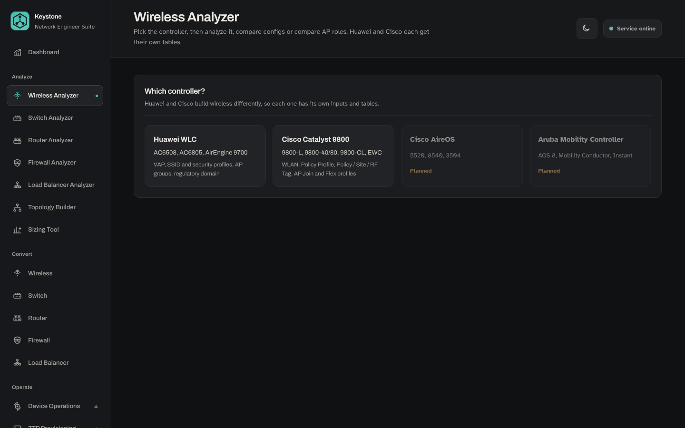

### Start here

**What to capture.** Pick the controller first; each family has its own tables.

- **Cisco Catalyst 9800** (9800-L, 9800-40/80, 9800-CL, embedded controller): one capture is enough, `show tech-support wireless`. It carries the configuration and the AP runtime state. Alternatively `show running-config` plus `show ap summary` and `show ap tag summary`. Command reference: [Catalyst 9800 show commands](https://www.cisco.com/c/en/us/td/docs/wireless/controller/9800/command-reference/b_wireless_cr/show-commands.html).
- **Huawei WLC** (AC6508, AC6805, AirEngine 9700): `display current-configuration`, plus `display ap all`, `display radio all` and `display ap lldp neighbor brief` for the runtime state, optionally the AP Info export (CSV / XLSX). Command reference: [display ap, WLAN AC V200R019C00](https://support.huawei.com/enterprise/en/doc/EDOC1100096312/159f8860/display-ap).
- Cisco AireOS and Aruba Mobility Controller appear in the picker as planned; they are not analyzed yet.

**Run it.**

1. Open **Wireless Analyzer** and press the card for your controller.
2. In **Select 9800 capture** (or **Select WLC config**) choose the file. The optional **AP Master** is your planned list of APs with their site, policy and RF tag (a template is linked on the page); with it the tool also validates that every AP landed where you planned.
3. Press **Analyze 9800** (or **Analyze Wireless**).

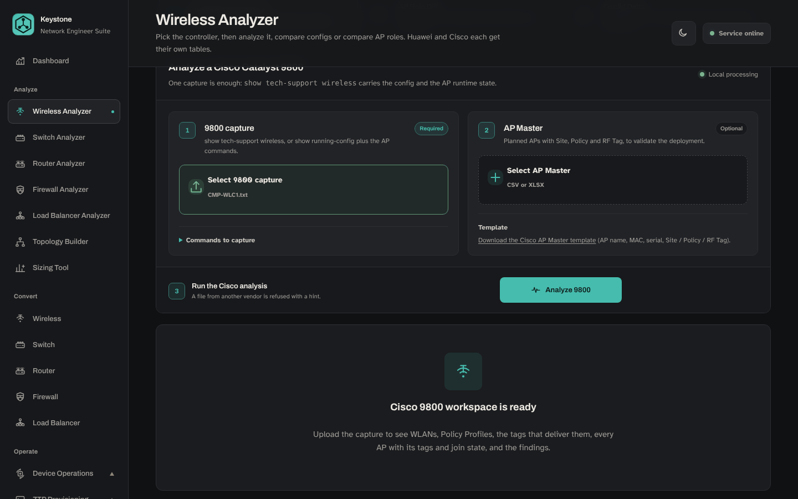

**Read it.** The cards at the top show the APs, how many are registered, WLANs up, policy tags and policy profiles, and the number of critical and warning findings. Then walk the tabs from left to right: **Overview** (controller identity, HA role, licences, AP models and whether they run the same software), **Findings**, **AP Inventory** (every AP with MAC, serial, IP, state, policy / site / RF tag, software), **WLANs**, **Policy Profiles**, **Tags**, **AP Join / Flex / RF**, **AAA & Users**, **Deployment Validation**.

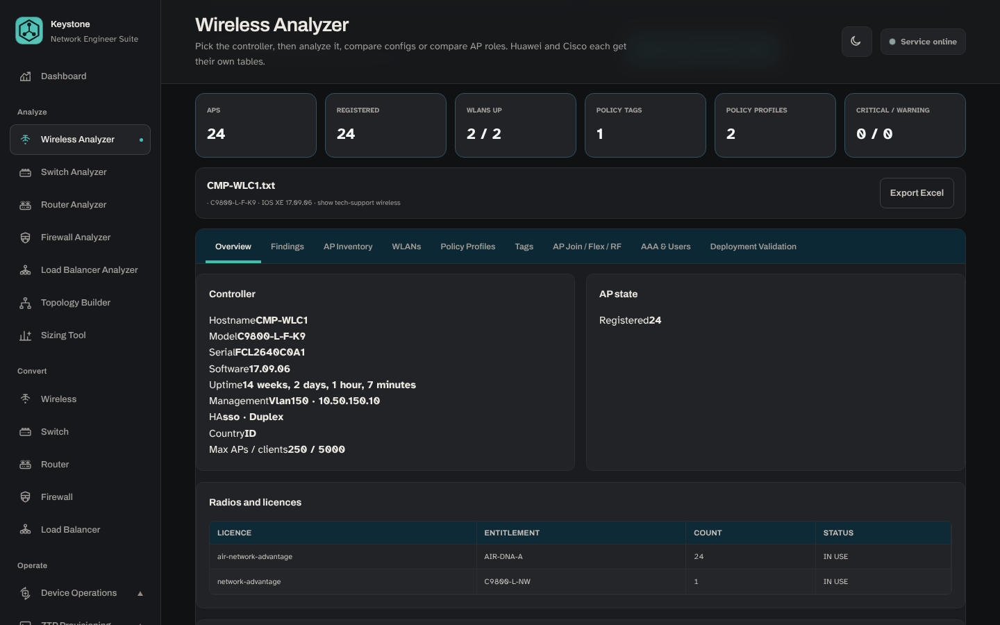

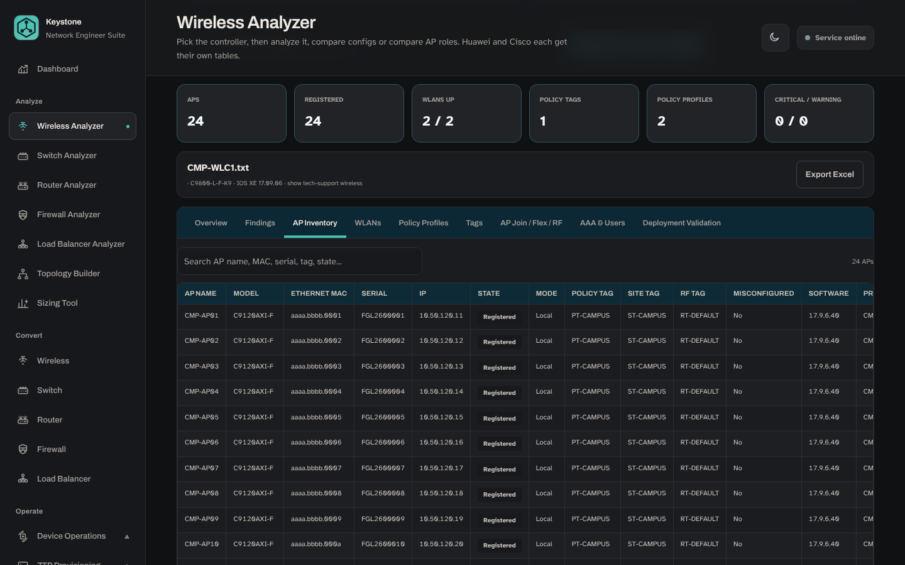

The Huawei view has the same idea with Huawei names: VAP profiles, SSID and security profiles, AP groups, regulatory domain, AP profiles, **Radio Planning** and local users.

### Going deeper

- **AP Role Diff** compares the AP tables of two controllers (active and standby, or old and new) by MAC, then serial, then AP name. Capture both within a minute or two of each other, or the join state will differ for reasons that are not a fault. On a Cisco controller the policy, site and RF tag are compared per AP; on Huawei the AP group is.
- **Config Delta** compares a source and a target configuration and produces implementation commands, which is the safe way to prepare a controller migration.
- **Huawei terminal logs.** A real session is often typed again and again. Keystone reads every table once, however often the session repeats, and replaces an LLDP neighbour name that the device cut with `...` by the full name from the detail dump. The radio table, the AP uplink (which switch and port each AP is on), the AP list and the power flag (an AP with insufficient PoE power becomes an **AP Power** finding) come from the runtime output, not from the configuration. Details: [docs/modules/wireless.md](modules/wireless.md).
- **Radio Planning** resolves which setting applies to each radio (the AP overrides its group), and flags a fixed channel without `calibrate auto-channel-select disable`, EIRP set while automatic power is still on, radios in monitor mode, and disabled radios.
- A file from the other vendor is refused with a message that names the vendor it looks like, so a Huawei file does not run through the Cisco parser.
- **Cisco join problems** are outside what a configuration shows. For the runtime side, Cisco's guide [Troubleshoot Catalyst 9800 AP Join or Disconnection Issues](https://www.cisco.com/c/en/us/support/docs/wireless/catalyst-9800-series-wireless-controllers/218396-troubleshoot-catalyst-9800-ap-join-or-di.html) is the reference.

---

## 4. Switch Analyzer

**Answers:** what is in this switch (model, serial, software, stack), how its ports, VLANs, trunks, spanning tree, port-channels, vPC / M-LAG, PoE and optics are configured and what state they are in, and what is wrong or risky.

### Start here

**What to capture.** Open **Switch Analyzer** and the **Collect Backup** tab, then take the list for your platform: Cisco Catalyst, Cisco Nexus, Aruba Switch (ArubaOS-Switch), Aruba CX, Huawei S / L / E-series, or Huawei H-series. The Catalyst list starts with `write memory`, then `term len 0`, `show clock`, `show run`, `show inventory`, `show version`, `show vlan brief`, and continues with the interface, spanning-tree, port-channel, CDP / LLDP, PoE, transceiver and logging commands. Save the whole terminal buffer in one `.txt` file.

You can also give a plain configuration export, but the `show` outputs are what fill the state tables (which port is up, who is the spanning-tree root, which optics are installed).

**Run it.**

1. Stay on **Single Device**. Drop the file (several files are read as several devices).
2. Leave **Vendor** on **Auto Detect** and **Baseline** on **None**.
3. Press **Analyze Switch**.

**Read it.** The **Overview** has a chart of interfaces up / down / admin-down / unknown, VLANs and routes, a device card (vendor, OS version, model, serial, stack mode) and, at the top, the number of findings split by severity. Then the tabs: **Interfaces**, **Routing**, **ARP**, **MAC Table**, **VLANs**, **CDP/LLDP**, **Port-Channel**, **Trunks**, **Spanning Tree**, **Transceivers**, **vPC/M-LAG**, **PoE**, **DNS**, **SNMP**, **Users**, **DHCP**, **Logs**, **Findings**, **Health**, **Coverage**. A tab that has no data in your capture is hidden under "Not in this capture" instead of showing an empty table.

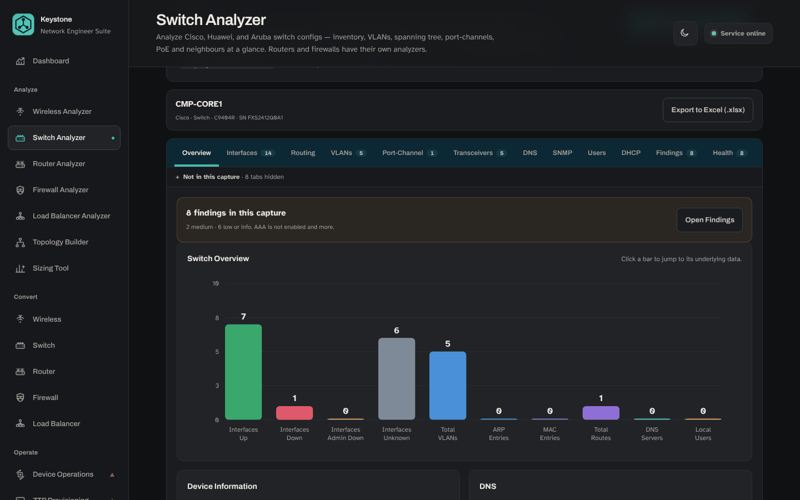

Open **Findings** and filter by severity or category. Each finding explains the problem, tells you the fix, and links to the vendor documentation.

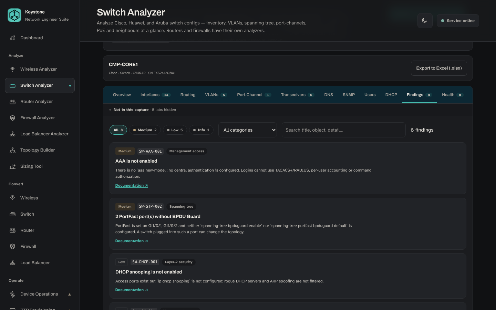

### Going deeper

- **Compare Devices** puts two captures side by side (for example before and after a change, or two members of a pair). **Sizing Assessment** looks at port usage and what a replacement would need; for a whole project use the [Sizing Tool](#9-sizing-tool).
- **Baseline** (next to Vendor) checks the capture against a standard, for example the NTP servers, the syslog host and the AAA decision of a converter profile. Deviations appear under the category *Baseline compliance*; with **None** nothing changes. Details: [docs/modules/switch-analyzer-baseline.md](modules/switch-analyzer-baseline.md).
- **Spanning tree**: the tool shows the root per VLAN and each port's role and type, and raises PortFast without BPDU guard. Cisco's behaviour is described in the [Catalyst 9300 spanning-tree guide](https://www.cisco.com/c/en/us/td/docs/switches/lan/catalyst9300/software/release/17-12/configuration_guide/lyr2/b_1712_lyr2_9300_cg/configuring_spanning_tree_protocol.html).
- **vPC and port-channels**: for Nexus, read the vPC tab together with Cisco's [vPC design and configuration guide](https://www.cisco.com/c/en/us/support/docs/switches/nexus-9000-series-switches/218333-understand-and-configure-nexus-9000-vpc.html); for LACP problems the [LACP troubleshooting guide](https://www.cisco.com/c/en/us/support/docs/lan-switching/link-aggregation-control-protocol-lacp-8023ad/221051-troubleshoot-link-aggregation-control-pr.html).
- **Aruba CX**: `show interface status`, `show interface desc` and `show power inline` are not valid on AOS-CX; the Aruba CX list uses the commands that are. Neighbour command reference: [show lldp neighbor-info](https://arubanetworking.hpe.com/techdocs/AOS-CX/10.13/HTML/fundamentals_8400/Content/Chp_Dev_disc/LLDP_cmds/sho-lld-nei-inf-10.htm).
- **Stacks.** A Huawei or Catalyst stack is one device with several members; the device card shows the stack mode, and the serial table lists every member.
- The Excel export has a **Health Details** sheet, so a reviewer without Keystone can read the whole result.

---

## 5. Router Analyzer

**Answers:** how the router is configured and how it is doing: interfaces, routing table, BGP and OSPF / EIGRP neighbours, VPN and crypto, NAT, ACLs, hardware and health, and which settings violate a hardening baseline.

### Start here

**What to capture.** Cisco IOS, IOS-XE (ISR, ASR1000, Catalyst 8200 / 8300 / 8500) or Catalyst SD-WAN (cEdge). Open the **Collect** list for your family. Use the IOS-XE list for classic IOS and IOS-XE routers, and the SD-WAN list for a router in controller mode, because `show sdwan ...` commands do not exist on a traditional router. The IOS-XE list starts with `write memory` and `terminal length 0`, then `show clock`, `show version`, `show running-config`, `show inventory`, `show ip interface brief`, `show interfaces`, `show etherchannel summary`, CDP, and the routing, BGP, OSPF, crypto and NAT commands. Commands under "Health, IOS-XE only" fail on classic IOS; that is harmless.

**Run it.**

1. Open **Router Analyzer** and drop the capture (leave the platform on Auto Detect if the page offers a choice).
2. Press **Analyze**.

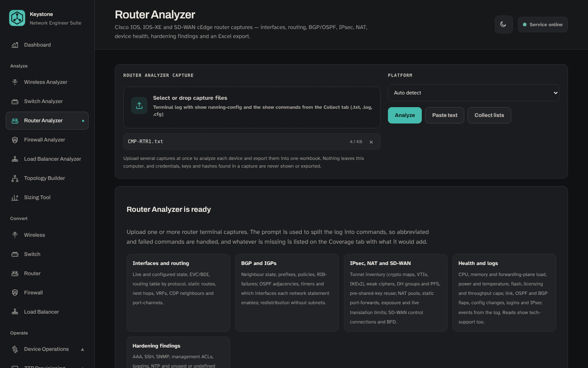

**Read it.** The **Overview** shows the platform, interfaces up, routes by source, BGP neighbours, ACLs, NAT rules, OSPF state, IPsec tunnels, and the count of High and Medium findings, with the most important findings listed beside the device information. Tabs: **Interfaces**, **Routing**, **BGP**, **OSPF / EIGRP**, **Policy objects**, **ACLs**, **Security**, **VPN & Crypto**, **NAT**, **Health**, **Hardware**, **Findings**.

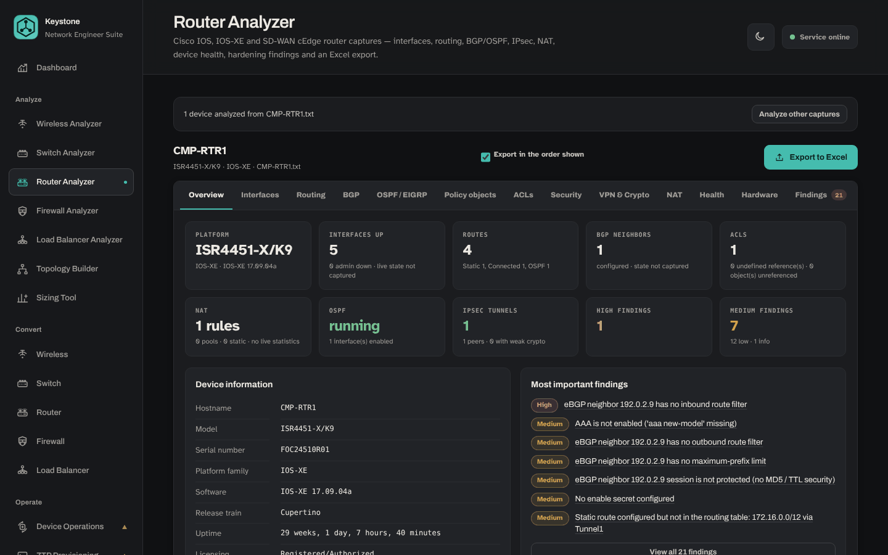

The findings are ranked High first, each with the object, the fix to type and a documentation link. In the invented example the High finding is an eBGP neighbour with no inbound route filter: everything the peer announces would be accepted, so a leak or hijack propagates straight into the routing table.

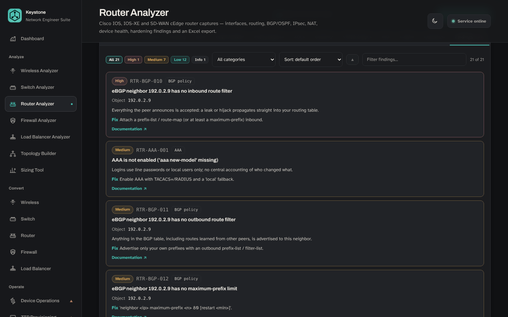

### Going deeper

- **Live state versus configuration.** A BGP neighbour that is "configured, state not captured" means the `show ip bgp summary` output was not in the file. The card says so instead of guessing; collect the full list to see the real session state.
- **SD-WAN.** For a cEdge capture the analyzer adds the SD-WAN control connections and BFD sessions to the usual tables. Cisco's design material: [Catalyst SD-WAN design guide](https://www.cisco.com/c/en/us/td/docs/solutions/CVD/SDWAN/cisco-sdwan-design-guide.html) and [BFD in Catalyst SD-WAN](https://www.cisco.com/c/en/us/td/docs/routers/sdwan/configuration/routing/ios-xe-17/routing-configuration-guide-17-x/cisco-catalyst-sd-wan-bfd1.html).
- **Health tab.** It needs `show version`, the CPU and memory process tables, the platform resources, and environment sensors. Without them the tab says what is missing.
- **Cisco IOS command reference** for every command in the list: [IOS XE command references](https://www.cisco.com/c/en/us/td/docs/ios-xml/ios/).
- **Show tech-support works too.** A `show tech-support` capture is read for CPU, memory, forwarding-plane load, power, temperature, flash, licensing, throughput caps and the log (link, OSPF and BGP flaps, configuration changes, logins, IPsec events).
- A router capture dropped on the Switch page is not forced through the wrong parser: the page tells you to use this analyzer.

---

## 6. Firewall Analyzer

**Answers:** which policies allow what, whether NAT, VPN and routing are as intended, how the box is managed and hardened, and what to fix first.

### Start here

**What to capture.**

- **FortiGate** (FortiOS 6.4 to 7.6): `get system status`, `show full-configuration` (the complete configuration including defaults; on a multi-VDOM box run it from the global context), then `get router info routing-table all`, `get router info bgp summary`, `get vpn ipsec tunnel summary`, `get system ha status`, `get system performance status`. Reference: [FortiOS CLI reference](https://docs.fortinet.com/document/fortigate/7.6.6/cli-reference/84566/fortios-cli-reference). FortiSwitch captures are read too.
- **Palo Alto PAN-OS**: from operational mode `set cli pager off`, `set cli config-output-format set`, then `configure`, `show`, `exit`, `show system info`, `show high-availability state`, `show routing route`, `show vpn ike-sa`, `show vpn ipsec-sa`. An XML export of the running configuration also works. Reference: [PAN-OS CLI cheat sheet](https://docs.paloaltonetworks.com/ngfw/pan-os-cli-quick-start/cli-cheat-sheet-device-management). A **Panorama** export can be uploaded together with the exports of the firewalls it manages (up to 60 files); each firewall is then analysed together with its template stack and device groups.
- **MikroTik RouterOS 6 / 7**: `/export verbose` (do not export secrets), plus `/system resource print` and `/ip route print`.

**Run it.** Open **Firewall Analyzer**, drop the file(s), press **Analyze**. Use the **Collect** tab of the page for the exact list for your platform.

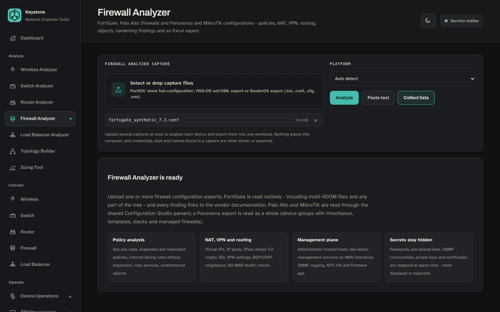

**Read it.** The **Overview** shows the platform and version, interfaces (and how many face the internet), management exposure, policies (accept / deny / disabled), VPNs, HA mode and group, and the counts of High and Medium findings. Tabs: **Interfaces**, **Policies**, **NAT & Local-in**, **Routing**, **SD-WAN**, **VPN**, **System**, **Hardening**, **Findings**, **Coverage**, **Collect**.

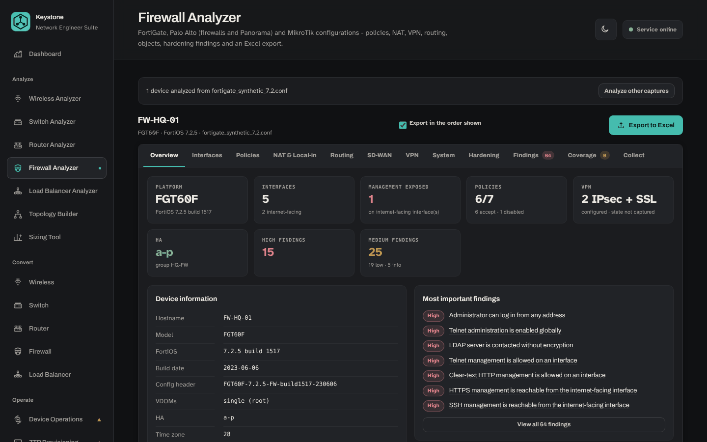

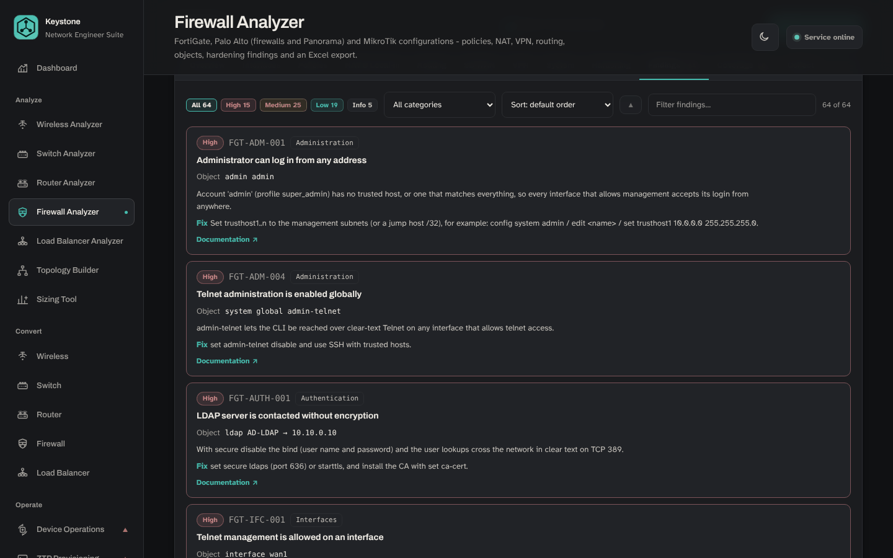

### Going deeper

- **Management exposure** is computed per interface: an administrative service allowed on an interface that faces the internet is a finding of its own, separate from "service enabled globally". **Policy analysis** covers any-source / any-destination / any-service rules, shadowed and redundant policies, internet-facing rules without inspection, risky services and unreferenced objects.
- **Palo Alto policy practice.** Findings follow the PAN-OS [security policy best practices](https://docs.paloaltonetworks.com/best-practices/security-policy-best-practices/security-policy-best-practices/deploy-security-policy-best-practices). For Panorama-managed firewalls the rule order is pre-rules, local rules, then post-rules; see [device group policies](https://docs.paloaltonetworks.com/panorama/administration/manage-firewalls/manage-device-groups/manage-the-rule-hierarchy).
- **Coverage tab.** If the `show full-configuration` output is missing, Coverage says so, and the findings that need defaults (for example a protocol enabled by default) are skipped rather than guessed.
- **Neighbours and ARP** in the lists (`diagnose lldprx neighbor details` on FortiOS 7.6.2 and earlier, `diagnose lldp rx neighbor details` on 7.6.3 and later; `show lldp neighbors all` on PAN-OS) are used by the [Topology Builder](#8-topology-builder), not by the analyzer. FortiGate receives LLDP by default only on WAN-role interfaces; enable it per interface if you want the links drawn.
- **Convert** (in the menu) moves a MikroTik firewall to Palo Alto, and FortiGate and PAN-OS in both directions, with a report of everything that did not carry over. See [docs/modules/configuration-studio.md](modules/configuration-studio.md).

---

## 7. Load Balancer Analyzer

**Answers:** what the F5 publishes (virtual servers), where it sends the traffic (pools, members, monitors), how TLS is configured, whether the pair is in sync, and what is wrong.

### Start here

**What to capture.** F5 BIG-IP LTM (TMOS 12.1 to 17.x), and a BIG-IP DNS (GTM) unit. Pick one of:

- a **UCS archive** (`.ucs`, or a `.qkview` diagnostic archive): System, Archives, Create, or `tmsh save sys ucs <name>`. It holds the configuration, the certificate files, licence and subscription dates. See F5's [archives documentation](https://techdocs.f5.com/en-us/bigip-14-1-0/big-ip-system-essentials-14-1-0/archives.html).
- `bigip.conf` (and `bigip_base.conf`), or
- the output of the list on the **Collect** tab, run from `tmsh`: `tmsh show sys version`, `tmsh show sys hardware`, `tmsh show sys provision`, `tmsh show sys failover`, `tmsh show sys ha-status`, then `tmsh list` (the whole configuration), the `all-properties` lists of client-SSL and server-SSL profiles and virtual servers, `tmsh list sys file ssl-cert`, `tmsh list auth user`. A read-only (Auditor or Guest) account is enough. Run it on **both units of an HA pair**: the state differs. Command reference: [tmsh `sys ha-status`](https://clouddocs.f5.com/cli/tmsh-reference/latest/modules/sys/sys_ha-status.html).

**Run it.** Open **Load Balancer Analyzer**, drop the file(s), press **Analyze**.

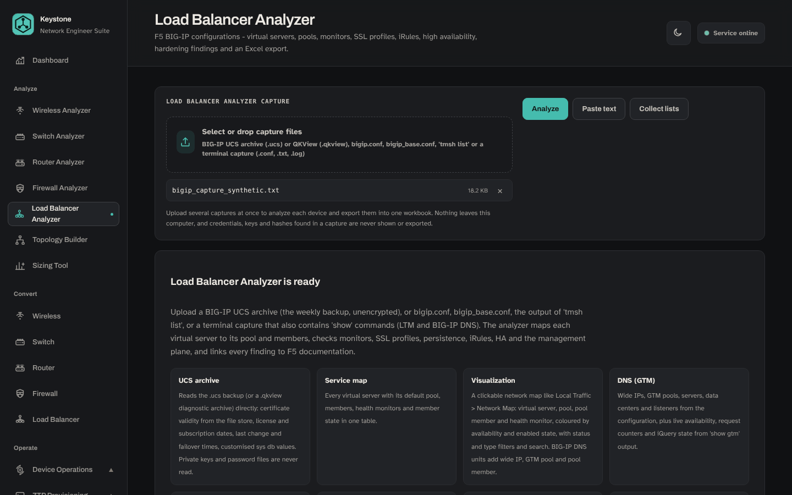

**Read it.** The **Overview** has the platform and release, virtual servers (and how many are public or disabled), pools and members, SSL profiles (and how many allow legacy protocols or ciphers), certificates (and which expired, with how many days ago), HA and config-sync state, management exposure, and the counts of High and Medium findings. Tabs: **Visualization** (virtual server to pool map), **Virtual servers**, **Pools & nodes**, **Monitors**, **SSL & profiles**, **iRules & policies**, **Network**, **High availability**, **System**, **Hardening**, **Security**, **Inventory**, **Live state**, **Findings**, **Coverage**, **Collect**.

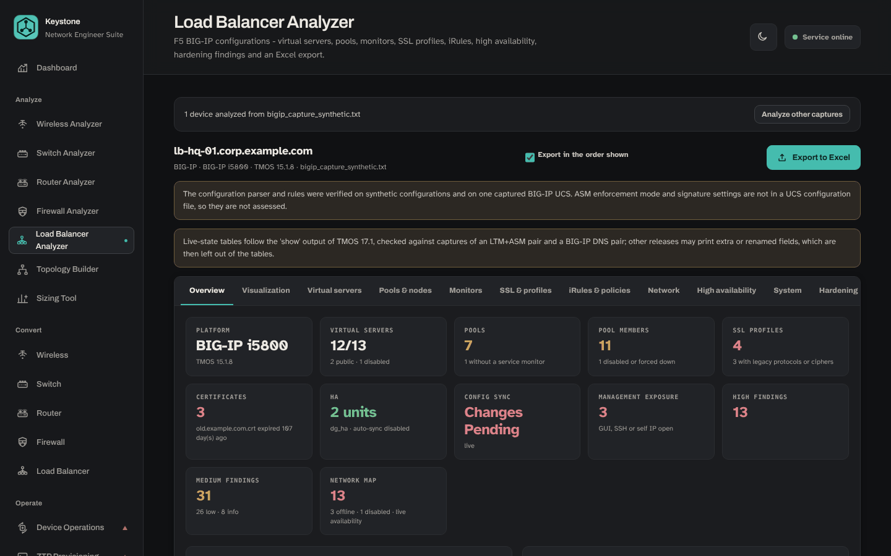

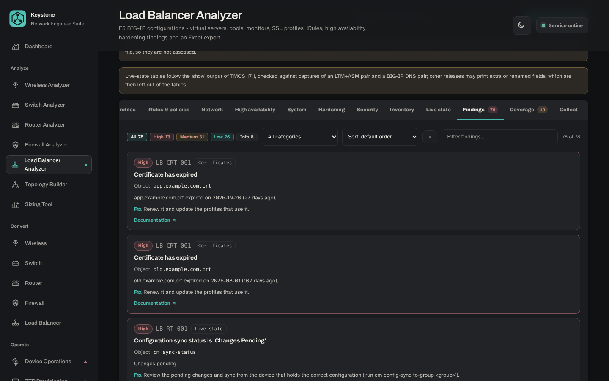

### Going deeper

- **Configuration versus live state.** A UCS tells you what is configured; whether a member is actually up, and whether the pair is in sync, comes from the `tmsh show` outputs. The **Live state** tab and the "Changes Pending" card appear only when those outputs were captured. Offline members and "disabled" versus "forced down" are explained in F5's [LTM object status indicators](https://techdocs.f5.com/en-us/bigip-14-1-0/big-ip-tmos-routing-administration-14-1-0/dynamic-routing/about-route-health-injection/about-route-advertisement-of-virtual-addresses/ltm-object-status-indicators.html).
- **Certificates and time.** "Expired N days ago" is computed from today's date, so the same capture raises more findings next month.
- **GTM / BIG-IP DNS** wide IPs, pools and servers are read from the DNS list (`collect-lb-f5-dns.txt`); object reference: [gtm wideip](https://clouddocs.f5.com/cli/tmsh-reference/latest/modules/gtm/gtm_wideip_a.html).
- **vCMP and partitions.** Run the list on the host and on every guest you care about; a vCMP host capture shows the guests, not what they publish.
- Before you share a buffer, search it for `password`, `secret`, `passphrase` and `$M$` (encrypted values).

---

## 8. Topology Builder

**Answers:** how the devices are really cabled. It draws the network from the CDP and LLDP neighbours in your captures and gives you a draw.io diagram, with the port names on every line.

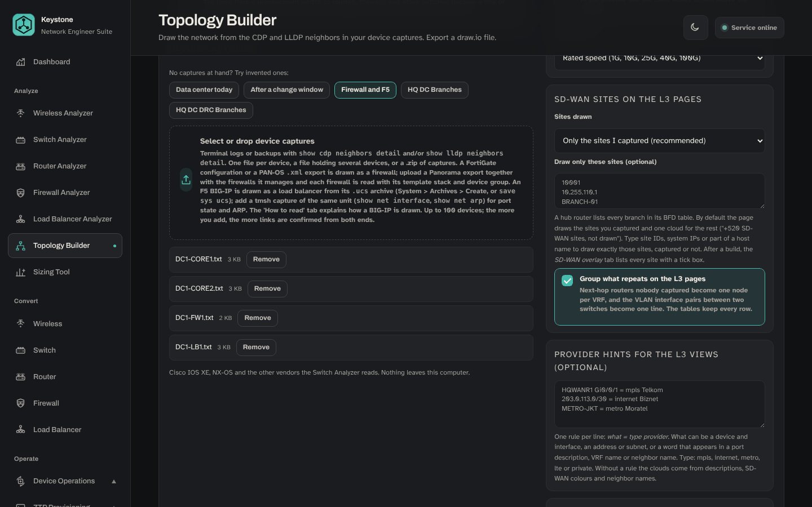

### Start here

**What to capture.** One capture per device (or a ZIP). Each capture should contain `show cdp neighbors detail` and `show lldp neighbors detail` (the links), `show etherchannel summary` / `show port-channel summary` and `show vpc` (bundles and vPC pairs), `show inventory` and `show version` (model, serial, stack members), and optionally `show mac address-table`, `show ip arp` and `show ip interface brief` (end hosts and routed links). The Switch Analyzer collect lists already include most of these, so a capture taken for the Switch Analyzer works here. FortiGate, Palo Alto, and F5 BIG-IP (`.ucs`, plus a `tmsh` capture of the same unit for port state and ARP) are drawn too. The more devices you add, the more links are confirmed from **both** ends.

**Run it.**

1. Open **Topology Builder**. No captures at hand? Press one of the invented sets (**Data center today**, **After a change window**, **Firewall and F5**, **HQ DC Branches**, **HQ DC DRC Branches**).
2. Optionally type a **Topology name**; every download is then named after it.
3. Keep the default options for the first run. Press **Build topology**. A progress bar shows the step and the seconds so far.

**Read it.** The cards say how many devices were captured, how many were only seen by a neighbour, the links, how many are confirmed from both ends, how many from one end only, conflicts, vPC pairs and findings.

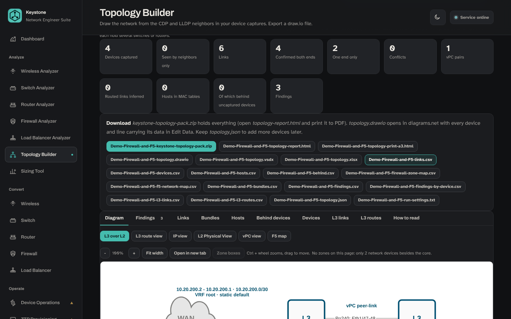

The **Diagram** tab shows the picture. Choose the view: **L3 over L2**, **L3 route view**, **IP view**, **L2 Physical View**, **vPC view** or **F5 map**. The diagram can be zoomed and dragged, opened in a new tab, and used to trace a path hop by hop.

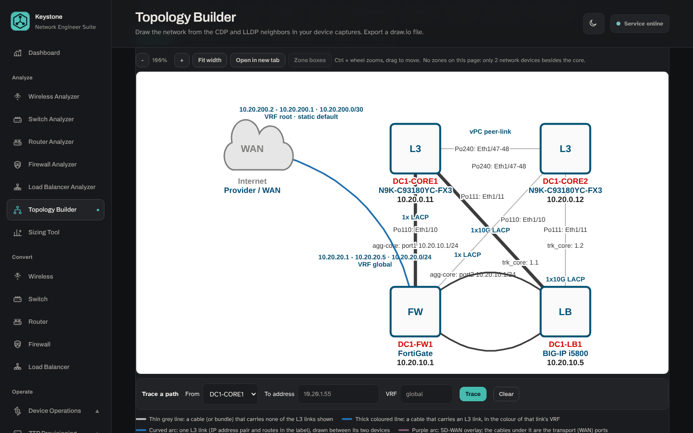

Download the **pack** (`.zip`) for everything: the `.drawio` file (open it in [diagrams.net / draw.io](https://www.drawio.com/)), an HTML report you can print to PDF, an Excel workbook, and CSV tables of links, bundles, hosts, devices, findings and what sits behind uncaptured devices.

### Going deeper

- **Findings** (`TOPO-001` ...) flag links reported by one end only although the peer was captured, port mismatches between the two ends, two captures that claim one hostname, CDP and LLDP that disagree, a bundle with one end in a port-channel and the other not, inter-switch links in spanning-tree blocking, MTU and OSPF parameters that differ between the two ends, and HSRP / VRRP groups compared between devices. The **Capture next** tab ranks the devices whose capture would add the most confirmed links, so you collect what matters instead of everything.
- **Where CDP / LLDP is silent** Keystone can infer a neighbour from the ARP table, then the MAC address table, then the port description (in that order of trust). Inferred links are marked as such; switch the option off if you only want proven cables. LLDP itself is specified in [IEEE 802.1AB](https://1.ieee802.org/maintenance/p802-1ab-2016-revision-station-and-media-access-control-connectivity-discovery/).
- **Large networks** are split into one page per site (**Grouping**: Automatic, one diagram, the first one to three hostname words, or **Sites, smart**). The placement follows the roles it finds (core, distribution, access, firewall, load balancer, WAN) and the cables, not the names.
- **Keep your layout and add devices later.** Pick the `topology.json` of the previous run under **Add to a previous run**, and the `.drawio` you rearranged under **Keep my layout**. **Compare two runs** shows what changed after a change window.
- **A controller's access points** appear under the switch port they are plugged into when the controller capture lists them (Huawei `display ap lldp neighbor brief`) and the switch is also captured.
- **Anonymized copy** replaces hostnames, domains, descriptions, IP and MAC addresses and serial numbers the same way everywhere and gives you a key file; send the copy to a vendor and keep the key.
- Campus design background for reading the result: [Cisco Campus LAN and Wireless LAN design guide](https://www.cisco.com/c/en/us/td/docs/solutions/CVD/Campus/cisco-campus-lan-wlan-design-guide.html). Every option and finding is documented in [docs/modules/topology.md](modules/topology.md).

---

## 9. Sizing Tool

**Answers:** what exactly do I have, so that I can size and quote its replacement. It builds one inventory of every access point, controller, switch, router, firewall and load balancer from any mix of captures: hardware, modules, optics, licences, and the features in use, grouped by device type.

### Start here

**What to capture.** Whatever you have, from any vendor: Cisco, Huawei, Aruba, FortiGate, Palo Alto, F5, MikroTik. The more the capture contains (`show version`, `show inventory`, licence output, transceivers, PoE), the more complete the inventory. The tool tells you what is missing under **Gaps and inputs** and offers a short read-only command list per platform. No capture at hand? The demo **Campus with wireless and licences** has ten invented captures of every family.

**Run it.**

1. Open **Sizing Tool**. Type a project name and the **growth margin** (target = today x (1 + growth)).
2. Drop the captures (any number, a ZIP is fine) or press a demo set.
3. Press **Build the sizing inventory**.

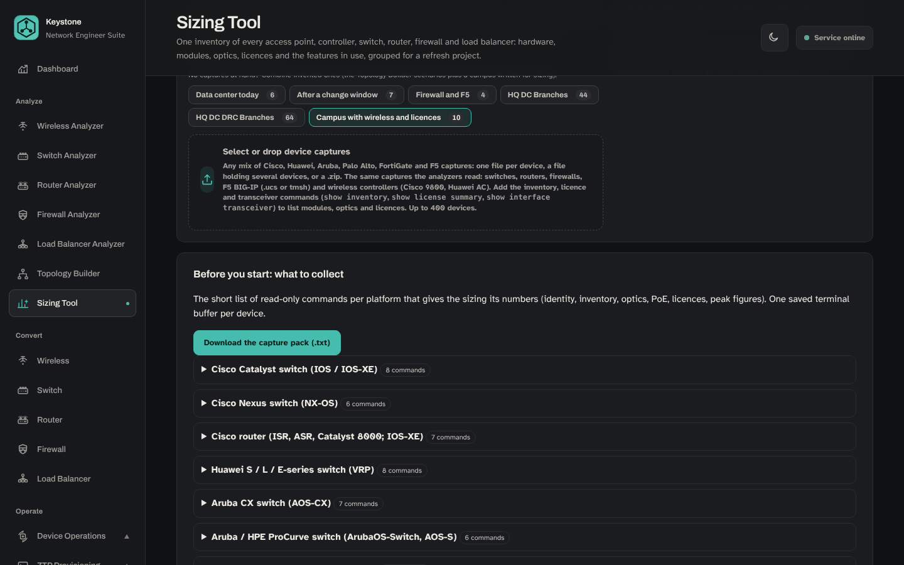

**Read it.** The cards show devices, access points, controllers, switches, routers, firewalls, load balancers, brands, sites, how many devices have licence output, and how many licences end within the window you set. The tabs: **By device type** (models, quantity, tier, redundancy, software), **Replacement plan**, **Bill of materials**, **Licences**, **Expiry**, **Peak figures**, **Features in use**, **Devices**, **Evidence**, **Sites**, **Imports**, **Compare**, **Gaps and inputs**.

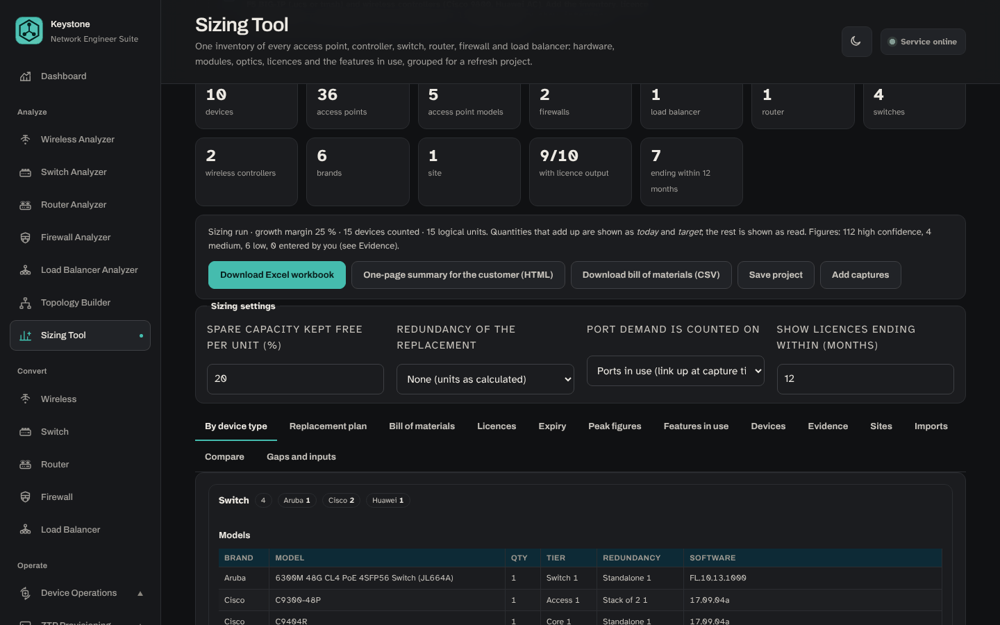

The **Replacement plan** is where the architect decides. For each group (for example the access switches) type the capacity of **one unit of the model you are considering** (from its datasheet) and the tool computes how many units are needed from today's ports, PoE power and optics, the target after growth, the spare capacity you keep free and the redundancy you choose (none, N+1, 2N).

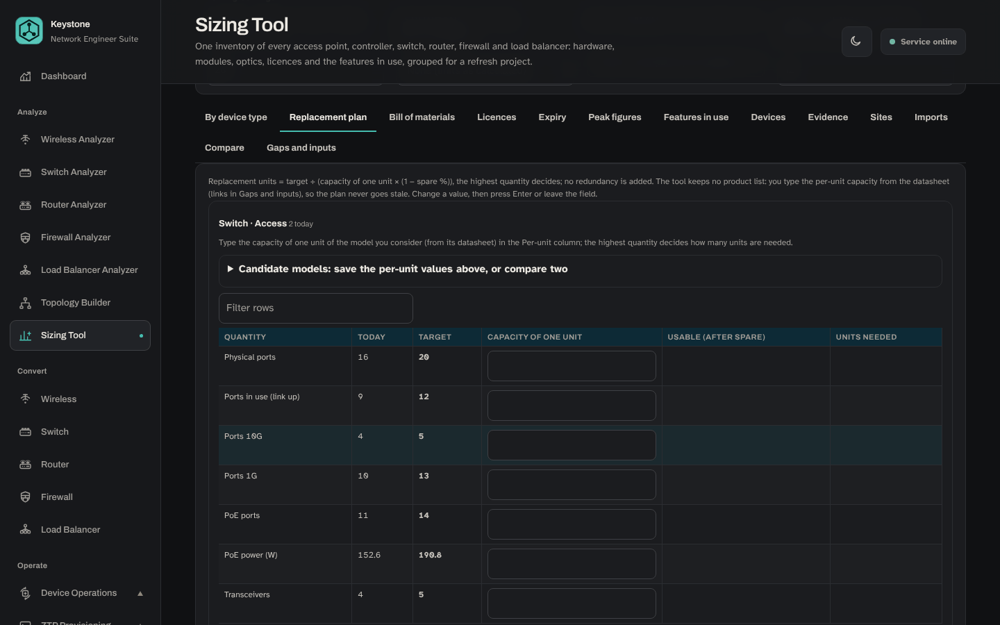

**Licences** lists what is in use, with the licence tier the replacement needs and the renewal windows that can be co-termed.

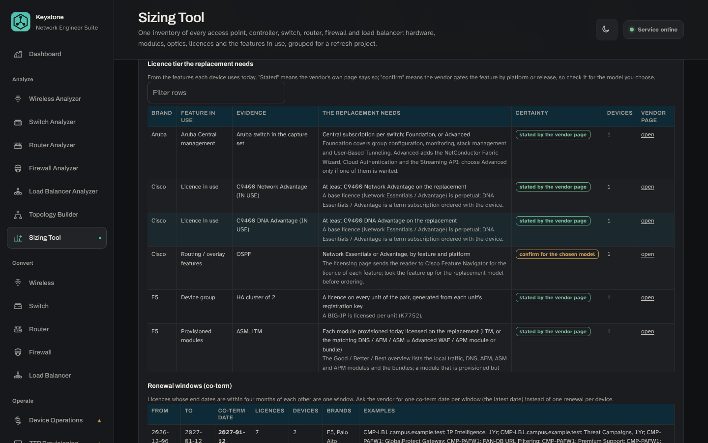

Export the **Excel workbook**, the **bill of materials (CSV)** for a quoting tool, or the **one-page summary** (HTML) for the customer. **Save project** gives a `.sizing.json` file you can reopen later or add captures to.

### Going deeper

- **Nothing is priced and no product catalogue ships with the tool.** You type the per-unit capacity yourself, or save it as a candidate model in the **candidate library** (export and import as JSON) and compare two candidates side by side. That keeps the numbers yours and auditable.
- **Evidence.** Every number carries its source and a confidence (high, medium, low, entered). A capture that said nothing about a figure does not get a guess; you type it, and it is marked "entered".
- **Partial captures of one device are merged** (same serial, or same hostname and kind) instead of one being dropped, and the sources are listed. **Redundant pairs** (Cisco vPC, Huawei M-LAG and VRRP hot standby, Aruba VSX, FortiGate FGCP, Palo Alto active/passive, Cisco ASA failover, Catalyst 9800 HA SSO, F5 device group) are found from the **configuration** (mirrored peer addresses, domain or group IDs, neighbour tables), not from hostnames, and counted as one logical unit. A stack or a StackWise Virtual pair is one device already. If only one member of a pair was captured, the pair is flagged. Background: [FortiGate FGCP](https://docs.fortinet.com/document/fortigate/8.0.0/administration-guide/62403/fgcp), [Palo Alto active/passive HA](https://docs.paloaltonetworks.com/pan-os/10-0/pan-os-admin/high-availability/set-up-activepassive-ha/configure-activepassive-ha), [Cisco vPC](https://www.cisco.com/c/en/us/support/docs/switches/nexus-9000-series-switches/218333-understand-and-configure-nexus-9000-vpc.html).
- **Firewalls are sized on the right throughput.** From the rules in use (plain firewall, application control, threat prevention, decryption) the tool picks the datasheet column that matches, and the plan shows which number it used. Datasheets: for example the [Palo Alto PA-3400 series](https://paloaltonetworks.com/resources/datasheets/pa-3400-series) and the [Cisco Secure Firewall 3100 series](https://www.cisco.com/c/en/us/products/collateral/security/firewalls/secure-firewall-3100-series-ds.html).
- **Licence tiers.** Features found in the configuration map to the tier the replacement needs, marked **stated** (the capture proves it) or **confirm** (a person must check). Licensing references: [Cisco DNA subscription matrix for switching](https://www.cisco.com/c/m/en_us/products/software/dna-subscription-switching/en-sw-sub-matrix-switching.html), [FortiGate security bundles](https://www.fortinet.com/support/support-services/fortiguard-security-subscriptions/fortigate-security-bundles), [Palo Alto licensing](https://docs.paloaltonetworks.com/resources/licensing-registration-activation), [F5 good-better-best licensing](https://www.f5.com/pdf/licensing/good-better-best-licensing-overview.pdf).
- **Imports** accept your site map, measured peak figures, licence entitlements exported from the vendor portal (Cisco Smart Account / SNTC, FortiCare, Aruba Central / GreenLake, Palo Alto CSP) and a lifecycle table of end-of-sale dates. Cisco's end-of-life listing: [products EOS / EOL](https://www.cisco.com/c/en/us/products/eos-eol-listing.html).
- **Compare** two saved runs to see what changed between two surveys. Full description of every option: [docs/modules/sizing-tool.md](modules/sizing-tool.md).

---

## 10. One capture, several tools

The same file can feed more than one tool; you do not collect twice.

| Capture | Wireless | Switch | Router | Firewall | Load Balancer | Topology | Sizing |
| --- | :-: | :-: | :-: | :-: | :-: | :-: | :-: |
| Cisco 9800 `show tech-support wireless` | yes | | | | | | yes |
| Huawei AC `display current-configuration` + runtime tables | yes | | | | | links to switches | yes |
| Catalyst / Nexus / Huawei / Aruba switch collect list | | yes | | | | yes | yes |
| Cisco IOS-XE / SD-WAN router collect list | | | yes | | | yes | yes |
| FortiGate / Palo Alto / MikroTik | | | | yes | | yes (FortiGate, Palo Alto) | yes |
| F5 `.ucs` or `tmsh` | | | | | yes | yes | yes |

A file sent to the wrong analyzer is not forced through the wrong parser: the page tells you which one to use.

---

## 11. Words you will see

- **Capture**: the text you saved from a terminal session (commands and their output).
- **CDP / LLDP**: protocols with which a device announces itself to its neighbours (name, port, model). CDP is Cisco's, LLDP is the standard ([IEEE 802.1AB](https://1.ieee802.org/maintenance/p802-1ab-2016-revision-station-and-media-access-control-connectivity-discovery/)). They are how Keystone knows who is cabled to whom.
- **Port-channel / LACP**: several cables bundled into one logical link.
- **vPC / M-LAG / VSX / VSS / SVL**: two switches that act as one to the devices below them. Vendor names for the same idea.
- **HA (high availability)**: two units, one active and one standby (or both active).
- **HSRP / VRRP**: a virtual gateway address shared by two routers ([VRRP is RFC 5798](https://www.rfc-editor.org/rfc/rfc5798)).
- **Hardening**: switching off what you do not need and protecting what you do (management access, logging, authentication).
- **Finding**: something Keystone found that you should look at, with a severity (High, Medium, Low, Info).
- **UCS**: the F5 BIG-IP archive of a unit.
- **N+1**: one spare unit more than the load needs.

---

## 12. When something does not work

| What you see | What to do |
| --- | --- |
| "File not recognised" or the page names another analyzer | Use the analyzer it names, or collect again with the list from the **Collect** tab of the right tool. |
| A table is empty | Open **Coverage**: the command was not in your file, or the device rejected it. Collect the full list. |
| The capture stops in the middle | The terminal buffer was too short. Increase the scrollback of your terminal tool (MobaXterm, PuTTY, SecureCRT) or log the session to a file. |
| `--More--` in the capture | Turn paging off for your session (`terminal length 0`, `screen-length 0 temporary`, `no page`, `set cli pager off`). |
| Topology shows few links | Add the neighbour devices' captures, and make sure LLDP is enabled on the interfaces. See **Capture next**. |
| The numbers in the Sizing Tool look low | Open **Gaps and inputs**; type the missing figures (they are marked "entered") or add captures with licence and transceiver output. |
| Anything else | Troubleshooting table in the [README](../README.md#troubleshooting). |

---

## 13. Reference documentation

Every link below is the vendor's own documentation.

**Cisco**

- [Catalyst 9800 command reference: show commands](https://www.cisco.com/c/en/us/td/docs/wireless/controller/9800/command-reference/b_wireless_cr/show-commands.html)
- [Troubleshoot Catalyst 9800 AP join or disconnection](https://www.cisco.com/c/en/us/support/docs/wireless/catalyst-9800-series-wireless-controllers/218396-troubleshoot-catalyst-9800-ap-join-or-di.html)
- [Catalyst 9300 spanning tree (17.12)](https://www.cisco.com/c/en/us/td/docs/switches/lan/catalyst9300/software/release/17-12/configuration_guide/lyr2/b_1712_lyr2_9300_cg/configuring_spanning_tree_protocol.html)
- [Nexus 9000 vPC](https://www.cisco.com/c/en/us/support/docs/switches/nexus-9000-series-switches/218333-understand-and-configure-nexus-9000-vpc.html)
- [LACP troubleshooting](https://www.cisco.com/c/en/us/support/docs/lan-switching/link-aggregation-control-protocol-lacp-8023ad/221051-troubleshoot-link-aggregation-control-pr.html)
- [IOS XE configuration guides](https://www.cisco.com/c/en/us/td/docs/ios-xml/ios/)
- [Catalyst SD-WAN design guide](https://www.cisco.com/c/en/us/td/docs/solutions/CVD/SDWAN/cisco-sdwan-design-guide.html)
- [Campus LAN and WLAN design guide](https://www.cisco.com/c/en/us/td/docs/solutions/CVD/Campus/cisco-campus-lan-wlan-design-guide.html)

**Huawei**

- [WLAN AC V200R019C00 command reference: display ap](https://support.huawei.com/enterprise/en/doc/EDOC1100096312/159f8860/display-ap)

**Aruba (HPE)**

- [AOS-CX 10.13: show lldp neighbor-info](https://arubanetworking.hpe.com/techdocs/AOS-CX/10.13/HTML/fundamentals_8400/Content/Chp_Dev_disc/LLDP_cmds/sho-lld-nei-inf-10.htm)

**Fortinet**

- [FortiOS CLI reference](https://docs.fortinet.com/document/fortigate/7.6.6/cli-reference/84566/fortios-cli-reference)
- [FGCP high availability](https://docs.fortinet.com/document/fortigate/8.0.0/administration-guide/62403/fgcp)

**Palo Alto Networks**

- [PAN-OS CLI cheat sheet](https://docs.paloaltonetworks.com/ngfw/pan-os-cli-quick-start/cli-cheat-sheet-device-management)
- [Security policy best practices](https://docs.paloaltonetworks.com/best-practices/security-policy-best-practices/security-policy-best-practices/deploy-security-policy-best-practices)
- [Panorama rule hierarchy](https://docs.paloaltonetworks.com/panorama/administration/manage-firewalls/manage-device-groups/manage-the-rule-hierarchy)

**F5**

- [BIG-IP archives (UCS)](https://techdocs.f5.com/en-us/bigip-14-1-0/big-ip-system-essentials-14-1-0/archives.html)
- [tmsh reference: sys ha-status](https://clouddocs.f5.com/cli/tmsh-reference/latest/modules/sys/sys_ha-status.html)
- [LTM object status indicators](https://techdocs.f5.com/en-us/bigip-14-1-0/big-ip-tmos-routing-administration-14-1-0/dynamic-routing/about-route-health-injection/about-route-advertisement-of-virtual-addresses/ltm-object-status-indicators.html)

**Standards and tools**

- [IEEE 802.1AB (LLDP)](https://1.ieee802.org/maintenance/p802-1ab-2016-revision-station-and-media-access-control-connectivity-discovery/)
- [RFC 5798 (VRRP)](https://www.rfc-editor.org/rfc/rfc5798)
- [diagrams.net / draw.io](https://www.drawio.com/)

Module details inside this repository: [docs/modules/wireless.md](modules/wireless.md), [docs/modules/topology.md](modules/topology.md), [docs/modules/sizing-tool.md](modules/sizing-tool.md), [docs/modules/panorama.md](modules/panorama.md), [docs/modules/switch-analyzer-baseline.md](modules/switch-analyzer-baseline.md).
